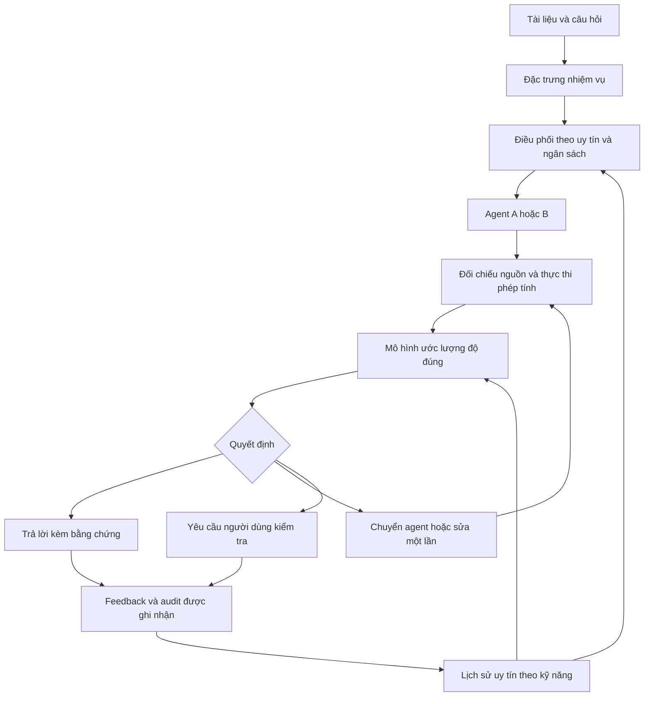

# RepGuard — hướng triển khai đồ án tốt nghiệp có prototype

**Ngày:** 18/10/2026. **Trạng thái:** đề xuất thiết kế và kế hoạch thực hiện; chưa phải phương pháp đã được kiểm chứng hoặc protocol thí nghiệm đã khóa.

**Ràng buộc người thực hiện đã xác nhận:** làm theo nhóm; còn 5–6 tuần; ngân sách model/GPU khoảng 2–5 triệu VNĐ; cần giữ đề tài multi-agent/reputation đã thông báo, có thể thay phương pháp. Chưa có rubric cụ thể của trường hoặc số thành viên. Kế hoạch chia thành hai luồng công việc, điều chỉnh nhân sự theo nhóm thực tế.

## 1. Đề xuất chính

Giữ tên đề tài RepGuard/ECRT đã thông báo và câu hỏi trung tâm: **feedback lịch sử đáng tin tới đâu, liên quan đến nhiệm vụ hiện tại tới đâu, và nên cho agent nào quyền xử lý/trả lời?** Triển khai câu hỏi đó thành một **hệ thống đa tác tử phân tích báo cáo có bảng số liệu, có uy tín theo kỹ năng, kiểm chứng nguồn và phép tính, và điều phối theo chất lượng–chi phí**.

Mô tả sản phẩm dùng khi trao đổi với giảng viên:

> “Nhóm xây dựng prototype RepGuard để điều phối các tác tử AI theo uy tín được hiệu chuẩn từ lịch sử và bằng chứng thực thi. Hệ thống được minh họa trên hỏi đáp định lượng từ báo cáo doanh nghiệp: chỉ rõ nguồn số liệu, thực hiện phép tính, phát hiện dấu hiệu sai và chuyển tác tử hoặc yêu cầu xác nhận khi cần.”

Tên đề tài chính thức giữ nguyên. “Phân tích báo cáo doanh nghiệp” là bối cảnh ứng dụng cho prototype. Phần thay đổi là thuật toán và thiết kế thực nghiệm. Nếu phạm vi ứng dụng chưa có trong đề cương đã duyệt, nhóm dùng bản mô tả trên để thống nhất phạm vi với giảng viên trước khi dành nhiều công sức cho ingestion/UI.

Đầu ra chính là **phần mềm chạy được + một mô hình học từ dữ liệu + kết quả đánh giá trên người dùng/nhiệm vụ cụ thể**. HistRepEval và các kết quả âm trước đây làm nền cho thiết kế, đối chứng và chương phân tích; không đặt chúng làm sản phẩm chính của đồ án.

## 2. Căn cứ lựa chọn

| Phương án trong trục RepGuard | Giá trị demo | Khả năng tận dụng hiện tại | Rủi ro trong 5–6 tuần | Đánh giá |
|---|---|---|---|---|
| Uy tín và điều phối agent cho hỏi đáp số liệu có nguồn | Người dùng tải dữ liệu, hỏi, xem nguồn/phép tính, thấy agent chuyển giao và lịch sử uy tín | Hiểu FinQA, có providers, episode/reputation, audit, cost traces, analyzers | Sai bảng/năm/đơn vị; kiểm chứng ngữ nghĩa còn khó | **Ưu tiên** |
| Uy tín cho agent Text-to-SQL đọc dữ liệu doanh nghiệp | Demo BI rõ, SQL thực thi được | Có thể tái dùng reputation/provider, cần adapter và schema/evaluator mới | SQL chạy được vẫn có thể sai ý nghĩa; thêm công xây dựng schema/retrieval | Phương án hai nếu nhóm đã có DB ứng dụng |
| Uy tín cho agent sửa lỗi code | Có sửa lỗi và chạy tests | Có MBPP inventory và inference harness | Tests có thể thiếu; dễ thành coding assistant chung, khó thể hiện transfer/reputation | Chỉ chọn khi nhóm đã có pipeline code tốt |
| Agent thao tác ứng dụng qua AppWorld | Demo phong phú nếu chạy ổn | Đã có nhiều pilot | Agent nền đã nhiều lần trượt gate; setup/version/transport nặng | Không ưu tiên cho thời hạn này |

Đây là đánh giá khả thi của người rà soát, không phải điểm số thực nghiệm cho các phương án.

Nguồn sơ cấp hỗ trợ hướng ưu tiên:

- **FinQA** cung cấp câu hỏi trên bảng và văn bản, chương trình suy luận và đáp án thực thi. Đây là nguồn supervision/evaluation phù hợp với evidence + arithmetic. [Paper](https://aclanthology.org/2021.emnlp-main.300/), [mã/dữ liệu](https://github.com/czyssrs/FinQA).
- **TAT-QA** có bảng kết hợp đoạn văn, đáp án/derivation/scale, phù hợp kiểm tra chuyển sang nguồn dữ liệu khác. [Trang chính thức](https://nextplusplus.github.io/TAT-QA/).
- **Program of Thoughts** tách phần suy luận của LLM khỏi tính toán bằng chương trình. Vì vậy program generation/execution phải được ghi nhận là thành phần kế thừa. [Paper](https://arxiv.org/abs/2211.12588).
- **FINDER, EMNLP 2025** đã kết hợp retrieval và Program of Thought trong financial QA. Đối chứng cần có hệ retrieval + program đủ mạnh, không chỉ chatbot trả lời trực tiếp. [Paper](https://aclanthology.org/2025.emnlp-main.1577/).
- **CRITIC** nghiên cứu kiểm tra/sửa đầu ra bằng công cụ. Kế hoạch dùng external evidence là lựa chọn có cơ sở, chưa là đảm bảo verifier của nhóm sẽ đúng. [Paper ICLR 2024](https://proceedings.iclr.cc/paper_files/paper/2024/hash/fef126561bbf9d4467dbb8d27334b8fe-Abstract-Conference.html).
- **FrugalGPT** đã nghiên cứu learned cascades để cân bằng cost và quality. Cascade hoặc gọi model mạnh khi cần tự nó không là novelty. [Paper](https://arxiv.org/abs/2305.05176).
- **FinRobot** đã có multi-agent financial applications và tính toán có provenance. Do đó một UI tài chính nhiều agent chưa đủ phân biệt đồ án; cần thể hiện riêng cơ chế reputation/evidence và ablation. [Repository tác giả](https://github.com/AI4Finance-Foundation/FinRobot).

Các nguồn trên là căn cứ thiết kế và phạm vi đóng góp. Kế hoạch không tuyên bố đã so thắng các hệ thống này.

## 3. Phạm vi sản phẩm đủ nhỏ để hoàn thành

**Người dùng:** người cần tra cứu và kiểm tra số liệu trong một báo cáo doanh nghiệp, ví dụ nhân viên tổng hợp báo cáo, sinh viên hoặc trợ lý phân tích. Trước hết kiểm tra nhu cầu bằng 3–5 cuộc trao đổi ngắn với người có làm báo cáo số liệu.

**Nhiệm vụ hỗ trợ:** tra một chỉ tiêu theo năm; tính chênh lệch; tính tăng trưởng; tính tỷ trọng; so sánh/chuỗi tối đa vài phép toán. Nguồn ban đầu là bảng CSV hoặc bảng+đoạn văn chuẩn hóa từ FinQA; bổ sung một số PDF có text và bảng dễ trích xuất cho demo. CSV/bảng chuẩn hóa là đường vào ổn định khi PDF ngoài phạm vi.

MVP giữ một báo cáo/lần, số bảng nhỏ, câu hỏi có phạm vi rõ. Quét PDF/OCR khó, giao dịch, dự báo chứng khoán, crawling dữ liệu trực tiếp và hệ agent nhiều bước trên nhiều ứng dụng được để ngoài MVP. Khi xem PDF, lưu page/table/row/cell IDs thực từ quá trình xử lý; không dựng vị trí trang cho dữ liệu chỉ có context chuẩn hóa.

Màn hình chính cần có:

1. Tài liệu/bảng và câu hỏi bằng ngôn ngữ tự nhiên.
2. Kết quả kèm đơn vị, kỳ/năm, ô hoặc đoạn trích hỗ trợ và công thức đã tính.
3. Trạng thái kiểm tra tách bạch: nguồn, phép tính, ràng buộc và độ tin cậy ước lượng.
4. Giải thích lựa chọn agent, lần chuyển giao, latency và chi phí thực ghi nhận.
5. Trang lịch sử uy tín theo kỹ năng/agent, nguồn feedback và trạng thái đã kiểm toán.
6. Chế độ so sánh cấu hình và xuất kết quả/trace để đưa vào báo cáo.

## 4. Kiến trúc và vai trò thực sự của multi-agent/reputation

Chỉ cần **hai agent giải bài**, cùng một hợp đồng đầu ra, một bộ điều phối và một bộ kiểm chứng deterministic. Bộ kiểm chứng không cần được gọi là agent AI.

| Thành phần | Chức năng |
|---|---|
| Agent A | Cấu hình gọn/nhanh: chọn bằng chứng và xuất câu trả lời, phép toán và dẫn nguồn có cấu trúc |
| Agent B | Cấu hình có reasoning/tool budget lớn hơn: xử lý câu phức tạp hoặc sửa lỗi với feedback cụ thể |
| Reputation store | Lịch sử năng lực theo kỹ năng, số mẫu, loại feedback, nhãn audit, chi phí; có smoothing và phiên bản |
| Controller | Chọn agent ban đầu từ thông tin trước suy luận; sau đầu ra quyết định chấp nhận, chuyển agent hoặc yêu cầu kiểm tra |
| Evidence/execution verifier | Kiểm tra cấu trúc, nguồn operands, ràng buộc rõ, đơn vị và thực thi phép toán được cho phép |

Agent được định nghĩa bằng **model + prompt/scaffold + tools + budget**, không chỉ tên model. Cả hai trả cùng schema: `answer`, `unit`, `period`, `evidence_ids`, `operands`, `program`, `status`. Chi phí đầu vào/đầu ra và retry được ghi cho từng call. Một agent mạnh hơn có thể thắng accuracy ở mọi skill; ứng dụng vẫn có mục tiêu giảm cost khi agent nhẹ đã đủ tốt. Không bắt buộc phải tìm hai model thay nhau thắng accuracy rồi mới được xây prototype, như gate chuyên gia của study cũ.

Luồng xử lý:

Tối đa một chuyển giao hoặc sửa lại trong MVP. Không tạo vòng debate/retry không giới hạn.

## 5. Phần AI do nhóm xây dựng

**Trọng tâm phương pháp:** thay reputation score chung và weighted voting bằng **ước lượng độ đúng theo nhiệm vụ, bằng chứng hiện tại và lịch sử agent**, rồi dùng nó để điều phối có ngân sách.

Ứng viên supervised:

\[
\hat p = f_\theta(\text{question features},\ \text{agent configuration},\ \text{skill reputation},\ \text{current verification trace}).
\]

Đây là xác suất thực nghiệm cần calibration; không phải chứng chỉ đúng. Đầu vào gồm:

- Loại câu hỏi suy ra từ chính câu hỏi, số năm/chỉ tiêu, độ dài/context và loại phép toán dự kiến.
- Uy tín agent trên nhóm nhiệm vụ liên quan, số nhãn audit, mức thiếu evidence, thống kê cost; nhóm ít mẫu co về prior chung.
- Kiểm tra nguồn operands, match năm/đơn vị, lỗi thực thi, phép toán hợp lệ, bằng chứng thiếu/mâu thuẫn, mức phù hợp retrieval.

Huấn luyện Logistic Regression có regularization trước; thử thêm một mô hình cây nhỏ nếu dữ liệu đủ. So sánh và chọn bằng validation, hiệu chuẩn trên phần calibration riêng. Nếu dùng embeddings, đóng băng encoder và cache; không bắt buộc fine-tune LLM/LoRA hoặc RL trong sáu tuần.

**Trước khi gọi agent**, controller chỉ được thấy question/document features và history đã có. **Sau khi agent trả lời**, model mới được thấy trace của agent đó. Không xem output hoặc verification của agent chưa gọi để quyết định có gọi nó hay không. Chính sách đơn giản cho MVP: kiểm tra cứng thất bại hoặc độ đúng ước lượng dưới threshold đã khóa thì chuyển agent nếu còn ngân sách. Tối ưu threshold trên validation; không cần học một policy RL.

Uy tín dùng năng lực theo thao tác, ví dụ extraction, difference, ratio/growth và multi-step. Các nhóm được gán ở runtime từ câu hỏi/parser/classifier; không đọc `gold program` để lấy skill của test task. Sự liên quan giữa nhóm có thể bắt đầu bằng rule minh bạch và so với global/no-transfer control. Không tái dùng nguyên taxonomy 14 môn MMLU.

**Điều cốt yếu về feedback:** `verified_trace`, rating người dùng, verdict judge và `audited_correctness` là các trường khác nhau. Chạy công thức thành công không tự cho nhãn gold. Feedback tự báo cáo hoặc thumbs-up chưa qua đối chiếu không được coi là audit. Nhãn chuẩn dùng để train/evaluate phải đến từ evaluator chính thức hoặc người kiểm tra đối chiếu nguồn. Khi dựng features cho mẫu train, reputation phải tính từ các episode trước hoặc out-of-fold, loại cả report của mẫu đó; không để nhãn của chính câu tạo ra feature uy tín cho nó.

Phần nhóm có thể bảo vệ như đóng góp trong phạm vi đồ án:

1. Mô hình reputation/risk có điều kiện theo task và bằng chứng; có huấn luyện, calibration và ablation.
2. Cơ chế chuyển giao hữu hạn cân bằng chất lượng, khả năng kiểm chứng và cost thực.
3. Prototype làm rõ history → reputation → lựa chọn agent → evidence → kết quả; có dữ liệu và trace tái lập.

Chỉ tuyên bố lợi ích từng phần khi thí nghiệm hỗ trợ. Không coi việc ghép các thành phần đã biết là một thuật toán SOTA mới.

## 6. Kiểm chứng được gì và còn giới hạn gì?

Chương trình biểu diễn dưới dạng AST/DSL với các phép toán đăng ký sẵn; interpreter dùng giá trị lấy từ source IDs. Không cần thực thi Python tùy ý do model tạo. Có thể kiểm tra cơ học nguồn có tồn tại, giá trị có khớp ô, kiểu dữ liệu/đơn vị, ràng buộc năm rõ, số chia và kết quả tính toán.

**Một chương trình chạy đúng vẫn có thể lấy nhầm dòng, chọn sai mẫu số hoặc hiểu sai câu hỏi.** Vì vậy trạng thái “phép tính đạt” không được biến thành nhãn “câu trả lời chắc chắn đúng”. Việc đối chiếu ngữ nghĩa giữa câu hỏi và bằng chứng là phần học/heuristic có thể sai, phải đánh giá riêng. Đây là lý do cần gold audit và risk model ngoài interpreter.

Giao diện nên ghi “Đã đối chiếu nguồn/phép tính; mức tin cậy ước lượng…” hoặc “Chưa đủ bằng chứng để kết luận”. Trường hợp retrieval không tìm thấy dữ liệu không đồng nghĩa tài liệu không có dữ liệu.

## 7. Dữ liệu và thực nghiệm vừa ngân sách

**Không coi các archived outputs cũ là kết quả của prototype mới.** Chúng giúp tìm lỗi và thiết kế đối chứng. Hai agent có schema/tools mới cần có inference mới.

Quota khởi điểm để lập dự toán, điều chỉnh sau pilot và grouping:

| Partition | Quota dự kiến | Quyền sử dụng |
|---|---:|---|
| History/train | Khoảng 500 câu, hai agent | Huấn luyện và xây history; dùng nhãn chuẩn công khai theo giao thức |
| Validation/calibration | Khoảng 120 câu, tách nhỏ cho calibration và chọn policy | Chọn threshold/model; không đưa sang final |
| Final | Khoảng 250 câu chưa dùng thiết kế | Khóa method trước, chạy/chấm một lần |
| Kiểm tra mở rộng | Khoảng 80–100 câu TAT-QA nếu thời gian cho phép | Đánh giá riêng, ghi rõ có adaptation hay zero-shot |
| Bộ ứng dụng | Khoảng 30–50 câu từ 5–10 tài liệu nhóm được phép dùng | Gold kiểm tra thủ công; phân biệt tiếng Việt với tiếng Anh |

Quota này chưa là split. Audit prompt hash/report ID để loại overlap với FinQA development200 đã xem và với archive dùng trước đó. Giữ câu cùng report/template trong cùng partition khi thiết kế grouped evaluation; nếu khác split chính thức, ghi rõ split dẫn xuất. Không tuyên bố tránh được contamination của pretraining chỉ bằng cách tách IDs.

Train dùng đầy đủ nhãn chuẩn là một lựa chọn hợp lệ cho đồ án supervised. **Không gọi nó là kết quả chỉ dùng10%gold.** Mọi baseline được quyền dùng cùng train labels. Thí nghiệm sparse audit10/20% là nhánh phụ chỉ làm nếu đã có app và final evaluation chính; phải tính cả nhãn dùng pretrain/calibrate và áp cùng quyền truy cập.

Nguồn FinQA công khai tách `pre_text/post_text/table/question` khỏi `program/gold_inds/exe_ans`. Chỉ loader offline được đọc targets. Các trường intermediate gold retrieval không được lẫn vào runtime inputs. README FinQA đã ghi một lỗi leakage trong preprocessing bảng ở bản cũ; dùng mã và formatter đã kiểm tra, không lấy nguyên script cũ theo tên. [Nguồn](https://github.com/czyssrs/FinQA).

Bộ tiếng Việt nhỏ cần người đối chiếu số, đơn vị, năm và nghĩa câu hỏi; không chỉ dịch tự động rồi gọi là đánh giá thực tế. Nếu chưa đủ thời gian, báo hệ thống hỗ trợ chính tiếng Anh và tiếng Việt là pilot.

## 8. Đối chứng và chỉ tiêu quyết định thành công

Giữ cùng document inputs, model versions và quyền truy cập nhãn. Đối chứng tối thiểu:

1. Agent mạnh nhất chạy một lượt, kèm cùng nguồn/công cụ thực thi khi phù hợp.
2. Pipeline evidence + program + kiểm tra cứng, không học reputation; đây là control kỹ thuật quan trọng.
3. Fixed cascade A→B với rule/threshold cố định, cùng giới hạn call.
4. GlobalBeta/uy tín thô, skill-conditioned reputation và ECRT gốc hoặc adaptation được mô tả đúng.
5. Gold-only skill reputation cùng nhãn train, để tách giá trị feedback khỏi nhãn đáng tin.
6. RepGuard đầy đủ; bỏ reputation nhưng giữ verifier/controller features khác để đo đúng đóng góp history.

Không cần tái hiện mọi prior work lớn. Nếu không chạy nguyên FINDER/FrugalGPT, ghi rõ control lấy cảm hứng hoặc adaptation; không nói đã đánh bại hệ gốc.

**Primary:** accuracy trên toàn tập câu hỏi theo đường chất lượng–tổng cost. Abstain tính là chưa giải được; báo riêng tại operating point khóa trên validation. Một mục tiêu kỹ thuật đáng nhắm là gần chất lượng agent mạnh với ít hơn20–30% inference cost, hoặc thêm khoảng3–5điểm% accuracy ở cùng budget. Đây là mục tiêu phát triển, chưa là dự báo hoặc kết quả; khả năng phân biệt bằng CI phải xét cỡ mẫu và discordance.

**Secondary:** sai nhưng được chấp nhận ở cùng coverage; tỷ lệ nguồn/đơn vị/năm đúng trên mẫu audit; rescue/harm sau chuyển agent; số call; token; latency p50/p95; chi phí theo bảng giá/hóa đơn thực; Brier/reliability của risk model; mức suy giảm dưới feedback sai. Tỷ lệ đúng trên các câu được trả lời phải đi kèm coverage và kết quả toàn tập, tránh tăng precision bằng từ chối gần hết.

Bootstrap theo report/group, ghép cặp từng câu và báo CI. Nhiều seed trên cùng câu không là nhiều người dùng độc lập. Thí nghiệm poisoning đổi feedback history trong khi giữ solver outputs thật; báo đó là can thiệp có kiểm soát, không phải attacker tự phát. Không cấp miễn phí gold hoặc kết quả agent thứ hai cho một baseline.

**Khả dụng:** thử nghiệm nhỏ với6–10 người nếu tuyển được, cho làm các tác vụ có đáp án, đo thời gian hoàn thành đúng và số lỗi bỏ sót so với quy trình tra cứu thông thường. Cân bằng thứ tự/tác vụ; ghi rõ mẫu tiện lợi và giới hạn. Chấm sự hữu ích bằng kết quả tác vụ, bổ sung khảo sát dễ dùng, không chỉ đánh giá giao diện đẹp.

## 9. Demo trước hội đồng

**Một câu chuyện5–7phút:**

1. Mở báo cáo/bảng thật đã chuẩn bị. Hỏi một câu định lượng; hệ thống chỉ agent được chọn và lý do dựa trên history.
2. Kết quả hiện đơn vị, năm, operands, công thức và vùng nguồn. Ví dụ minh họa: doanh thu1200→1500 cho tăng trưởng25%; khi triển khai dùng con số thực trong tài liệu.
3. Chạy một case phát triển đã có lỗi thực: nhầm năm/thiếu nguồn/sai tỷ lệ. Hiện check thất bại, chuyển agent một lần, rồi so kết quả. Nếu gài lỗi để minh họa, gắn nhãn rõ là tình huống can thiệp.
4. Nạp hai snapshot history đã kiểm toán từ các lượt chạy thật. Cho thấy agent từng được khen sai có uy tín thay đổi và cách điều phối thay đổi trên câu mới. Không ép một rating đơn lẻ làm đảo toàn bộ hệ thống hoặc làm giả tác động học.
5. Hỏi một câu thiếu bằng chứng; app chỉ rõ phần chưa xác minh và đề nghị kiểm tra thay vì dựng số.
6. Mở màn hình so sánh chính sách và cost–quality từ batch đã đánh giá; thử thêm một câu live ngoài kịch bản trong phạm vi hỗ trợ.

Replay dùng trace thật và được ghi nhãn replay. Live inference hiện trạng thái thực. Cần có snapshot/replay để trình bày khi mạng không ổn, không dùng cache lặng lẽ như một lượt gọi model mới.

## 10. Kế hoạch5–6tuần và phân công

| Tuần | Luồng AI/phương pháp | Luồng sản phẩm/dữ liệu | Mốc phải nhìn thấy |
|---|---|---|---|
| 1 | Audit data, khóa schema và hai agent; pilot80–100câu; đo chất lượng/cost và lỗi có thể kiểm tra | UI tối thiểu; import bảng/context; source IDs; log mọi bước | Một câu đi hết luồng thật từ dữ liệu đến đáp án/công thức |
| 2 | Reputation store và baselines; tạo history; train risk model đơn giản; ablation đầu | Panel nguồn/công thức/agent trace; chuyển giao hữu hạn | RepGuard có quyết định dựa trên history và trace, không chỉ màn hình mô phỏng |
| 3 | Calibration; chọn threshold; phân tích đóng góp history/verifier; freeze shortlist | PDF có text cho ít mẫu; feedback/audit panel; export traces | Prototype đầy đủ nhiệm vụ chính; chốt cấu hình trước final |
| 4 | Chạy final đã khóa và controls; CI, cost–quality; targeted feedback stress test | Sửa lỗi tích hợp, bổ sung bộ ứng dụng kiểm tra thủ công | Bảng kết quả chính tái lập được |
| 5 | Nếu còn thời gian: TAT-QA slice và user study; hoàn tất hạn chế/ablation | Ổn định demo, đóng gói chạy, video, hướng dẫn | Release candidate và bản thảo báo cáo hoàn chỉnh |
| 6 nếu có | Chỉ sửa lỗi có ảnh hưởng, không mở thêm cuộc tìm kiếm model | Diễn tập hội đồng, phương án mất mạng, kiểm hồ sơ | Bản nộp và demo ổn định |

Hai luồng chốt API/schema và ghép hệ thống hằng ngày. Các phần dùng chung: khóa split, kiểm gold isolation, chọn baseline và viết giải thích phương pháp. Nếu nhóm có hơn hai người, tách ingestion/UI khỏi evaluation/reporting; không chia theo “mỗi người một model” rồi cuối kỳ mới tích hợp.

**Điểm kiểm soát:**

- Cuối tuần1: nếu pilot cho thấy cả hai agent quá yếu, giảm độ khó thao tác và điều chỉnh solver/scaffold ngay. Nếu B mạnh hơn mọi nhóm, kiểm tra quality–cost frontier thay vì tiếp tục săn two-way rescue.
- Cuối tuần2: phải có kết quả so rule-only với learned reputation/risk trên development. Nếu history không giúp, kiểm tra representation/task grouping/feedback sources bằng một thay đổi có kiểm soát; trao đổi sớm với giảng viên về phần đóng góp thực tế. Không dành ba tuần cuối tìm công thức cho đến khi thắng.
- Cuối tuần3: đóng băng phạm vi và policy. Phần thêm được ưu tiên khi giảm rủi ro demo hoặc hoàn thiện chứng cứ, không chỉ tăng tính năng.

## 11. Ngân sách

Phân bổ quản lý dự kiến, chưa phải báo giá dịch vụ:

| Hạng mục | Tỷ lệ | Với2triệu | Với5triệu |
|---|---:|---:|---:|
| Pilot, đo cost thật, debug | 10% | 200.000 | 500.000 |
| Thu history và dữ liệu train hai agent | 35% | 700.000 | 1.750.000 |
| Huấn luyện nhẹ/embedding/compute cần thiết | 10% | 200.000 | 500.000 |
| Final evaluation và đối chứng | 25% | 500.000 | 1.250.000 |
| Retry, demo, dự phòng | 20% | 400.000 | 1.000.000 |

Sau20–30request đầu, tính cost mỗi case từ usage và đơn giá thật của provider; với GPU tự host dùng thời gian billable/startup thực. Chọn quota theo trần tiền còn lại. Tái dùng output giữa các replay policy khi cùng model/prompt/input; chỉ tính các output mà policy được phép truy cập khi mô phỏng cost. Thu dữ liệu counterfactual phục vụ train cũng là một khoản phải báo, dù cost serving của policy thấp hơn. Giá trị `cost_usd=0` do provider chưa có pricing không được diễn giải là inference miễn phí.

MVP dùng tối đa hai cấu hình agent và một vòng chuyển giao. Train model nhỏ trên CPU hoặc compute đã có; GPU thuê theo phiên khi có việc, không duy trì endpoint idle chỉ để giữ demo.

## 12. Tận dụng repository và phần cần viết mới

**Có thể tái dùng sau khi kiểm tra:** provider/harness/cache; seed/log; định dạng provenance; ECRT/AuditedECRT làm baselines; paired decision metrics, bootstrap/cost accounting; kinh nghiệm resume trên Modal.

**Cần viết mới hoặc adapter:** data contracts cho bảng/text/numeric answers; runtime history không chứa gold; evidence/source schema; arithmetic DSL/interpreter; risk model + feature pipeline; controller; API/UI; ingestion; application dataset; end-to-end evaluation.

`EpisodeRecord` hiện hướng MCQ, mang trường `_ground_truth` và `__repr__` có gọi kiểm tra đúng/sai. Không dùng nguyên record này làm object runtime sản phẩm. Tách đối tượng visible history khỏi gold/audit store vật lý. `transfer.py` hiện có taxonomy MMLU; thay bằng skill representation phù hợp trong adapter mới. Các baseline cũ giữ nguyên để bảo toàn tái lập.

Chưa có frontend/API sản phẩm trong các entry points đã kiểm tra. Không nên ước lượng phần app là “chỉ thêm UI”. Ngược lại, đội đã có lợi thế đáng kể ở thu inference, đối chứng và kiểm chứng kết quả; không cần viết lại toàn bộ hạ tầng hoặc học một framework agent lớn để bắt đầu.

## 13. Những gì làm hồ sơ bảo vệ thuyết phục

| Câu hỏi hội đồng có thể đặt | Bằng chứng nhóm cần đưa ra |
|---|---|
| Bài toán có ai cần? | Người dùng cụ thể, tác vụ tra cứu số liệu, kết quả phỏng vấn/user task nhỏ |
| Phần AI nhóm làm ở đâu? | Dataset/feature construction, learned reputation/risk, calibration, delegation policy, checkpoints và training curves/metrics phù hợp |
| Vì sao cần reputation? | Ablation bỏ history; global vs skill; feedback raw vs audited/calibrated; thay đổi hành động và cost/quality thực |
| Vì sao cần multi-agent? | So một agent mạnh cùng công cụ, fixed cascade và hệ đầy đủ ở cùng cost; có trace chuyển giao hữu ích |
| Có chỉ là gọi API? | Phần evidence binding, interpreter, model học từ dữ liệu, policy, isolation, reproducible evaluation do nhóm triển khai |
| Tốt hơn chỗ nào? | Chênh lệch đúng/sai, rescue/harm, coverage, cost/latency, CI trên final; không chỉ Brier hoặc hình UI |
| Giới hạn gì? | Semantic verification chưa hoàn hảo; phạm vi input/ngôn ngữ; dữ liệu public/pretraining; sample user nhỏ; cost phụ thuộc model |

Đây là cách chuẩn bị chất lượng đồ án theo mục tiêu AI ứng dụng, không thay rubric của trường và không bảo đảm một mức điểm cụ thể.

## 14. Bước thực hiện đầu tiên

Trong72giờ đầu nên tạo một vertical slice: **một bảng thật → một câu hỏi → agent → operands/source IDs → interpreter → kết quả hiện trên UI**, với call/token/latency ledger. Song song khóa pilot80–100câu development và rule-only baselines; chưa mua một batch hàng nghìn call hoặc fine-tune model lớn.

Hướng đề xuất giữ nguyên trục RepGuard: độ tin cậy feedback và sự phù hợp của history quyết định quyền xử lý của agent. Nó tạo một sản phẩm thực tế để trình diễn, và làm cho phần reputation phải chứng minh giá trị bằng hành vi hệ thống. Các thất bại ECRT/DART trước đây giúp lựa chọn thiết kế, tránh lặp lại proxy sai và bỏ phiếu kém hiệu quả; chúng không buộc đầu ra tốt nghiệp phải là một bài measurement.
