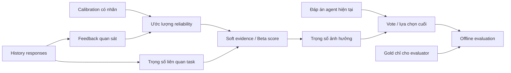

# RepGuard: Tổng quan nghiên cứu và báo cáo tiến độ

**Nội dung chuẩn bị trao đổi với giảng viên hướng dẫn • Ngày 27/10/2026**

**Tên đề tài đang dùng trong repo:** *RepGuard: Evidence-Calibrated Reputation Transfer under Imperfect Feedback in Multi-Agent LLM Systems*.

**Tên diễn giải tiếng Việt:** Đánh giá và chuyển giao uy tín tác tử dựa trên bằng chứng được hiệu chỉnh trong hệ đa tác tử LLM có phản hồi chưa hoàn hảo.

**Mốc thực nghiệm gần nhất được lưu:** 20/10/2026. Commit hiện tại khi rà soát: `f3c7446aeb1a212e9ac29314b6caac7e047fa4d5`, ngày 24/10/2026. Ngày commit không phải ngày phát sinh kết quả mới.

## Hướng dẫn sử dụng

Tài liệu gồm ba phần: **A. Literature review và cơ sở lý thuyết; B. Tiến độ có bằng chứng trong mã nguồn và kết quả; C. Định hướng, thiết kế nghiên cứu tiếp theo và nội dung trao đổi với Thầy**. Các đoạn “Cách trình bày” có thể chuyển thành lời nói khi thuyết trình. File [kịch bản slide](SLIDE_OUTLINE_VA_CAU_HOI_BAO_VE.md) đi kèm chọn nội dung cho một buổi khoảng 20–25 phút; không cần đưa toàn bộ tài liệu này lên slide.

Ký hiệu **[Rxx]** trỏ đến nguồn nghiên cứu gốc ở cuối tài liệu. Các kết quả RepGuard được dẫn tới file trong repo. “Bài báo báo cáo” là kết quả của tác giả công trình; “repo ghi nhận” là kết quả dự án. Hai loại bằng chứng không được gộp làm một thực nghiệm.

**Lộ trình đọc:** literature ở mục 1–11; kiến trúc/tiến độ ở mục 12–20; metrics, kế hoạch và lời thuyết trình ở mục 21–26. Đọc tóm tắt bên dưới trước, rồi dùng file slide để chọn phần trình bày. Các diễn giải dài và lịch sử negative results có thể giữ làm tài liệu trả lời hỏi đáp.

## Tóm tắt điều cần báo cáo với Thầy

Đề tài đã có một hệ thống nghiên cứu tương đối đầy đủ: bộ thu thập phản hồi model, quản lý splits và lịch sử, ECRT và nhiều baseline, cơ chế audit, replay quyết định, kiểm toán provenance, cùng prototype hỏi đáp số liệu tài chính. Nhiều vòng thực nghiệm đã hoàn tất trên MMLU-Pro, AppWorld, dữ liệu routing lưu trữ, FinQA và TAT-QA.

**Kết luận khoa học hiện tại: chưa xác nhận được lợi ích riêng của phương pháp reputation so với đầy đủ đối chứng mạnh.** Một số phép đo calibration hoặc điểm development cải thiện; các điều kiện đủ để tuyên bố phương pháp tốt hơn vẫn chưa đạt. Đây là tiến độ nghiên cứu có kết quả âm và phân tích nguyên nhân, không phải tình trạng đang chờ các đợt chạy đã hoàn tất.

Literature cho thấy nhiều ý tưởng ban đầu đã có tiền lệ: uy tín theo kỹ năng, mượn bằng chứng giữa kỹ năng, phối hợp lịch sử với chất lượng hiện tại, dùng judge với audit gold, kiểm tra ở mức claim, chọn sửa lỗi theo trạng thái và gán credit phản thực. Vì vậy, đóng góp tiếp theo cần được định nghĩa hẹp và kiểm chứng: **lịch sử nào thực sự giúp ra quyết định tốt hơn khi feedback chỉ kiểm được một phần, chi phí được tính đầy đủ và baseline được cung cấp cùng thông tin?**

Đợt rà soát 27/10 đọc và lập danh mục **291 file Python / 35.579 dòng** thuộc mã dự án, test và tiện ích phân tích; kiểm tra hành vi tập trung vào các thuật toán và luồng thực nghiệm chính. Bộ test hiện tại: **308 pass, 1 skip**. Hai kiểm toán receipt/source/execution vòng 3 được chạy lại và đều PASS. Phạm vi cụ thể và kết quả tính lại được ghi ở [hồ sơ kiểm chứng](verification_2026-10-27.json); đây không phải chứng minh hình thức mọi dòng mã hoặc mọi nhãn dữ liệu đều đúng.

# PHẦN A. LITERATURE REVIEW

## 1. Bài toán và các khái niệm cần nắm trước

### 1.1. Vì sao hệ nhiều agent cần một cơ chế đánh giá uy tín?

Trong phạm vi đề tài, một agent là một cấu hình thực thi, có thể khác agent khác về model nền, prompt, vai trò, công cụ, ngân sách token và cách tổ chức workflow. Hai agent cùng dùng một model vẫn có thể tạo ra các chính sách khác nhau; ngược lại, đổi tên vai trò chưa bảo đảm tạo ra hai chuyên gia có năng lực bổ sung.

Khi nhiều agent cùng trả lời, hệ thống phải quyết định giao việc cho ai, dùng đáp án nào, có gọi thêm người kiểm tra hay không và có cho phép sửa kết quả hiện tại hay không. Uy tín là thông tin rút ra từ lịch sử để hỗ trợ các quyết định đó. Điểm uy tín chỉ có giá trị thực tiễn nếu cách dùng điểm dẫn tới kết quả tốt hơn hoặc chi phí thấp hơn với chất lượng đã được kiểm chứng.

Ví dụ minh họa: agent A xử lý tốt câu hỏi đọc số trực tiếp, agent B làm tốt phép tính nhiều bước. Nếu chỉ tính tỷ lệ đúng toàn bộ, A có thể đứng đầu vì lịch sử chứa nhiều câu dễ. Giao mọi câu hỏi tăng trưởng nhiều năm cho A có thể bỏ lỡ năng lực của B. Nhưng nếu B mới có hai mẫu lịch sử, tin tuyệt đối vào tỷ lệ 2/2 cũng có thể là sai lầm. Hệ thống cần đồng thời xét **ngữ cảnh nhiệm vụ, lượng bằng chứng và độ đáng tin của cách chấm**.

### 1.2. Phân biệt năm đối tượng dễ nhầm

| Đối tượng | Câu hỏi nó trả lời | Ví dụ trong đề tài |
|---|---|---|
| Năng lực (*competence*) | Agent có xác suất làm đúng bao nhiêu trong một điều kiện? | Tỷ lệ đúng của Qwen3 14B trên một nhóm câu |
| Uy tín (*reputation*) | Lịch sử đang cung cấp bằng chứng gì về năng lực tương lai? | Posterior global/skill-conditioned |
| Feedback reliability | Tín hiệu “đúng” của người chấm đáng tin đến đâu? | Judge khen đáp án nhưng gold cho biết đáp án sai |
| Task transferability | Lịch sử cũ có liên quan tới nhiệm vụ mới đến đâu? | Kinh nghiệm tính tỷ lệ có hữu ích cho câu đọc số? |
| Decision value | Dùng thông tin này có cải thiện quyết định cuối không? | Chuyển A → B cứu thêm bao nhiêu câu, gây hại bao nhiêu? |

Một agent có uy tín cao không có nghĩa mọi đáp án hiện tại đều đúng. Một verifier chạy thành công không có nghĩa nó kiểm hết ngữ nghĩa. Đồng thuận giữa nhiều agent cũng không mặc nhiên tương đương nhiều bằng chứng độc lập.

### 1.3. Ba lớp bài toán trong repo

**Tổng hợp đáp án:** nhiều agent đã trả lời cùng một câu; hệ thống gán trọng số và chọn đáp án. Phải tính chi phí của các agent đã gọi.

**Chọn model từ lịch sử:** hệ thống dùng kết quả trên các câu trước để chọn một model cho workload mới. Nếu cùng một model được dùng cho mọi câu trong một fold, đó là lựa chọn model toàn cục trong fold, dù estimator có nhiều đặc trưng lịch sử.

**Routing/cascade theo trạng thái:** quyết định có thể thay đổi theo câu hỏi hoặc output hiện tại. Router trước suy luận chỉ thấy prompt/metadata; cascade sau A được phép thấy output A, nhưng phải trả chi phí A và mọi lượt gọi bổ sung. Không được nhìn output B trước khi quyết định có gọi B rồi vẫn tính giá như chỉ gọi một model.

Phân biệt này quyết định baseline nào hợp lệ. Không thể so một bộ tổng hợp đã thấy mọi output với prompt router chỉ có câu hỏi mà bỏ qua chênh lệch thông tin và compute.

## 2. Phạm vi và cách thực hiện literature review

Đây là **tổng quan có định hướng theo vấn đề nghiên cứu**, không phải một systematic review đã đăng ký PRISMA. Nguồn được tìm và đối chiếu tới 27/10/2026, ưu tiên ACL Anthology, PMLR, proceedings hội nghị, arXiv của tác giả và kho mã chính thức. Không dùng blog tổng hợp làm bằng chứng cho công thức hay kết quả phương pháp.

Các cụm tìm kiếm bao gồm *agent reputation, skill-conditional trust, imperfect feedback, LLM judge, limited human audits, prediction-powered inference, LLM routing, repair memory, counterfactual credit, claim-level financial verification*. Bài được chọn vì giúp xác định giả định, đối chứng hoặc rủi ro diễn giải của RepGuard. Những công trình giao trực tiếp với đề tài được đọc thêm phần phương pháp/giới hạn; các công trình bổ trợ được đối chiếu metadata và nội dung nguồn chính. Danh mục có 49 nguồn; không coi đó là 49 bài đã tái lập độc lập.

Tình trạng công bố được ghi riêng: ví dụ Credibility Scoring ở IJCNLP-AACL 2025; RouteLLM ở ICLR 2025; R2-Router và Multi-Agent Teams Hold Experts Back ở ICML 2026. Nhiều bài 2026 khác hiện được dẫn bằng preprint. CLAIR-Fin có ghi nhận chấp nhận FinNLP 2026 trên trang arXiv. **WEREWOLF đã có mục Findings of EMNLP 2026 trên ACL Anthology** [R06]; ghi chú cũ “chưa công khai” trong repo cần được xem là trạng thái lịch sử.

Các bài cùng chủ đề có thể sử dụng pool, evaluator, ngân sách và mục tiêu khác nhau. Bản review chủ yếu so **cơ chế, quyền truy cập dữ liệu và câu hỏi nghiên cứu**, không xếp hạng các bài bằng cách đặt accuracy trên các benchmark khác nhau cạnh nhau.

## 3. Nhánh 1: reputation từ lịch sử và uy tín có điều kiện

### 3.1. Beta Reputation System: nền tảng xác suất, không phải novelty của ECRT

Jøsang và Ismail xây dựng hệ reputation dựa trên phân phối Beta để tổng hợp phản hồi tích cực và tiêu cực [R01]. Với prior Beta(α₀, β₀), lịch sử gồm `s` lần thành công và `f` lần thất bại cho một mô hình Beta–Bernoulli đơn giản dẫn tới:

`θ | history ~ Beta(α₀ + s, β₀ + f)`

`E[θ | history] = (α₀ + s) / (α₀ + β₀ + s + f)`.

Ví dụ toán học minh họa: cùng prior Beta(1,1), agent có 1/1 đúng cho mean 2/3; agent có 90/100 đúng cho mean 91/102. Trường hợp thứ hai có nhiều bằng chứng hơn. Không nên chỉ so tỷ lệ 100% với 90% mà bỏ qua kích thước lịch sử.

**Hệ quả thiết kế cho RepGuard:** Beta là một baseline nền tảng phải có. Khi feedback là xác suất ước lượng và bằng chứng được nhân trọng số, việc cộng pseudo-counts vẫn tạo ra một biểu diễn Beta tiện dụng, nhưng không tự động là posterior Bayes chính xác của một mô hình đầy đủ có judge noise, phụ thuộc mẫu và uncertainty trong calibration. Cần phân biệt lựa chọn biểu diễn với một định lý đảm bảo độ tin cậy.

Nguồn: [The Beta Reputation System](https://www.mn.uio.no/ifi/english/people/aca/josang/publications/ji2002-bled.pdf).

### 3.2. Credibility Scoring: lịch sử đóng góp ảnh hưởng tới tổng hợp

Ebrahimi, Dehghankar và Asudeh mô hình hóa hỏi đáp hợp tác như một trò chơi lặp, cập nhật credibility từ đóng góp quá khứ và dùng credibility để tổng hợp output [R02]. Bài nghiên cứu khả năng chống ảnh hưởng của agent đối kháng, kể cả cấu hình đối kháng chiếm đa số. Đây là tiền lệ trực tiếp của việc dùng lịch sử để điều chỉnh ảnh hưởng trong nhóm LLM.

**Liên hệ:** RepGuard không nên nhận “chấm điểm agent từ lịch sử” hoặc “vote có trọng số reputation” là đóng góp mới. Phần cần kiểm riêng là độ tin cậy của feedback lịch sử, mức liên quan tới task mới và tác động tới quyết định ở cùng ngân sách. Khi so thực nghiệm, phải mô tả rõ baseline được tái lập hay chỉ được điều chỉnh theo ý tưởng của bài.

Nguồn: [An Adversary-Resistant Multi-Agent LLM System via Credibility Scoring](https://aclanthology.org/2025.ijcnlp-long.90/).

### 3.3. Conditional Agent Trust: công trình gần ECRT nhất về transfer

Xia và Wang nghiên cứu `R(agent | skill)`, pooling bằng chứng qua một ma trận coupling giữa kỹ năng, và điều kiện để conditioning có ích [R03]. Bài xét mức khác biệt năng lực, độ thưa của lịch sử và tương quan kỹ năng; dùng 14 agent AppWorld để đặt dữ liệu thực vào phân tích. Bài cũng chỉ ra kênh mượn bằng chứng có thể bị lợi dụng để laundering uy tín. Một giả định quan trọng ở phần setup là outcomes được môi trường kiểm chứng.

**Liên hệ:** task-conditioned reputation, borrowing và laundering đã có tiền lệ. Khác biệt RepGuard muốn nghiên cứu là feedback cũng có thể sai. Tuy nhiên, chỉ thay outcome sạch bằng một xác suất đã hiệu chỉnh chưa đủ thành đóng góp: cần kiểm xem nó thay đổi lựa chọn có ích và còn tốt hơn conditional/global controls hay không.

Nguồn: [When Should Agent Trust Be Conditional?](https://arxiv.org/html/2606.14200v1).

### 3.4. MiniRep: lịch sử kết hợp tín hiệu hiện tại và hạn chế nhóm clone

MiniRep đánh giá đồng thời chất lượng/rủi ro của proposal hiện tại với reputation qua thời gian; ảnh hưởng của các nhóm agent tương tự được hạn chế [R05]. Hệ thống gồm bộ phân tích response, aggregator có reputation và bộ cập nhật trạng thái sau khi quyết định hiện tại đã được cố định. Bài đánh giá trên nhiều loại task và điều kiện tấn công.

**Liên hệ:** kết hợp “history + current evidence” và giảm ảnh hưởng của đồng thuận tương quan không còn là gap có thể nhận chung chung. Đối với RepGuard, câu hỏi hẹp hơn là profile lịch sử sau audit có giúp lựa chọn agent hoặc scope sửa tốt hơn cùng các tín hiệu hiện tại, khi chất lượng nguồn feedback chưa hoàn hảo hay không. Không được giả định mọi proposal của các model cùng họ là mẫu độc lập.

Nguồn: [MiniRep](https://arxiv.org/html/2609.39297v1).

### 3.5. Tổng hợp nhánh reputation

Từ các công trình trên, có thể lập một chuỗi lập luận: lịch sử có ích để ước lượng hành vi tương lai; kỹ năng làm cho một reputation toàn cục có thể quá thô; pooling giảm variance nhưng có thể đưa vào bias hoặc mở kênh tấn công; tín hiệu ở task hiện tại vẫn cần được xét. **Khoảng trống cần kiểm không nằm ở việc “thêm lịch sử”, mà ở việc lượng hóa giá trị bổ sung của một cách biểu diễn và sử dụng lịch sử dưới điều kiện feedback cụ thể.** Đây là suy luận định vị của đề tài dựa trên [R01–R03,R05], chưa phải kết luận không có bài nào khác giải quyết giao điểm đó.

## 4. Nhánh 2: dùng được chuyên gia, quyền ảnh hưởng và tấn công reputation

### 4.1. Multi-Agent Teams Hold Experts Back

Pappu và cộng sự phân biệt nhận diện chuyên gia với tận dụng chuyên gia [R04]. Trong các nhóm tự tổ chức được khảo sát, team thường không đạt mức của thành viên mạnh nhất, kể cả khi biết ai là chuyên gia; tác giả liên hệ hiện tượng này với xu hướng dung hòa ý kiến. Kết quả không phải định lý rằng mọi workflow đa agent đều kém.

**Liên hệ:** phải đo đầu ra cuối thay vì dừng ở ranking đúng. Team biết B mạnh nhưng vẫn chọn đáp án dung hòa sai thì reputation chưa tạo utility. Best single agent và strong fixed workflow là đối chứng bắt buộc. Cần tách việc xác định ai tốt khỏi cơ chế biến điểm đó thành quyền quyết định.

Nguồn: [Multi-Agent Teams Hold Experts Back](https://arxiv.org/abs/2602.01011).

### 4.2. WEREWOLF: tấn công có cân nhắc duy trì quyền tham gia

WEREWOLF mô hình hóa Trojan agent lựa chọn lúc hợp tác và lúc phá hoại để vừa gây hại vừa duy trì quyền xuất hiện trong control plane [R06]. Công trình có phân tích threshold khi biết reputation và attacker học bằng primal–dual RL khi reputation bị ẩn. Điểm liên quan là attacker tối ưu theo thời gian, không nhất thiết phá mọi lượt.

**Liên hệ:** một thí nghiệm thay đáp án bằng forced-wrong hay bơm false-positive feedback chỉ là controlled intervention. Nó không tương đương tái lập attacker học chiến lược của WEREWOLF. Nếu RepGuard muốn có claim robustness, cần ghi threat model, quyền attacker, ngân sách và đối chứng riêng.

Nguồn: [WEREWOLF, Findings of EMNLP 2026](https://aclanthology.org/2026.findings-emnlp.2427/).

### 4.3. Trust No Tool và TrustFork: nguồn hình thành trust có thể bị đánh lừa

*Trust No Tool* nghiên cứu cognitive poisoning: tool tạo feedback có vẻ lành tính trước khi gây hại ở hành động cuối, và đề xuất đánh giá theo trajectory [R07]. Đối tượng trust ở đây là phản hồi công cụ, khác uy tín chuyên môn của teammate.

*TrustFork* giữ nguyên model bên trong nhưng thay danh tính hiển thị của subagent để khảo sát ảnh hưởng lên authority; benchmark cho thấy nhãn danh tính và việc bằng chứng có tới được orchestrator đều quan trọng [R39].

**Hệ quả cho thiết kế:** không coi tên model, giọng tự tin hay nhãn “expert” là bằng chứng đúng. Lưu model digest và lineage giúp biết output đến từ đâu, nhưng provenance chưa chứng minh nội dung đúng. Cần đánh giá xem evidence thực sự ảnh hưởng tới lựa chọn hay chỉ được hiển thị trong trace.

Nguồn: [Trust No Tool](https://arxiv.org/abs/2605.17453); [TrustFork](https://arxiv.org/abs/2609.32635).

### 4.4. Loop-Back Authority: cho quyền yêu cầu sửa cũng cần được kiểm chứng

Agachan và cộng sự so nhóm phẳng với nhóm có manager được trả bản thảo về để sửa trong tác vụ báo cáo business intelligence [R40]. Trong thiết kế đó, nhóm phẳng có chất lượng tốt hơn ở các chỉ tiêu được báo cáo; khác biệt xuất hiện sau revision. Không nên ngoại suy thành mọi cấu trúc phân cấp đều có hại.

**Liên hệ:** “thêm reviewer” là một can thiệp có thể cứu hoặc làm hỏng đáp án. Với RepGuard, quyền sửa, điều kiện chấp nhận và quyền giữ nguyên phải được đưa vào đánh giá. Accuracy của reviewer độc lập không thay thế được phép đo harmful correction sau khi reviewer tác động lên incumbent.

Nguồn: [Loop-Back Authority in LLM Agent Teams](https://arxiv.org/abs/2609.14767).

## 5. Nhánh 3: feedback chưa hoàn hảo, calibration và audit có gold

### 5.1. LLM-as-a-Judge: chất lượng đánh giá phải được đo trong đúng nhiệm vụ

Zheng và cộng sự nghiên cứu LLM judge với MT-Bench/Chatbot Arena, đồng thời khảo sát position bias, verbosity bias, self-enhancement bias và giới hạn reasoning [R08]. Agreement với human preference trong setup đó không phải chứng nhận rằng một judge có thể chấm chính xác phép tính tài chính hay trạng thái AppWorld.

**Liên hệ:** repo phải đo false positives/false negatives và calibration của judge trên task đang dùng. Judge JSON hợp lệ chỉ chứng minh giao diện hoạt động. Một xác suất judge hợp lệ vẫn có thể ít thông tin về agent nào tốt hơn trên cùng một câu.

Nguồn: [Judging LLM-as-a-Judge](https://arxiv.org/abs/2306.05685).

### 5.2. Calibration khác discrimination và khác utility

Guo và cộng sự nghiên cứu calibration của neural networks và các cách hậu xử lý confidence [R09]. Tinh thần cần dùng ở đây là xác suất dự đoán phải được so với tần suất đúng quan sát được; một model tự nói “90% chắc chắn” chưa tự tạo ra calibration.

Trong RepGuard, cần phân biệt:

1. **Calibration:** nhóm dự đoán khoảng 0,8 có thật sự đúng xấp xỉ 80% không?
2. **Discrimination/ranking:** có xếp agent/candidate đúng lên trên candidate sai không?
3. **Decision utility:** thứ hạng và ngưỡng đó có đưa tới quyết định tốt sau chi phí không?

Ví dụ tự xây dựng: nếu A và B đều bị đánh giá quá lạc quan, kéo cả hai xác suất xuống có thể giảm Brier. Nếu thứ tự vẫn là A>B trên mọi câu, router dùng argmax không đổi lựa chọn. Đây là lý do cần đo cả calibration lẫn quyết định; không thể dùng một chỉ tiêu thay cho tất cả.

Nguồn: [On Calibration of Modern Neural Networks](https://proceedings.mlr.press/v70/guo17a.html).

### 5.3. Prediction-Powered Inference, PPI++ và Cross-PPI

PPI kết hợp nhiều dự đoán với ít nhãn thật bằng một phần hiệu chỉnh sai lệch [R10]. PPI++ điều chỉnh mức sử dụng prediction theo chất lượng của nó [R11]. Cross-PPI phát triển cách dùng cross-prediction khi predictor cũng được học từ dữ liệu có nhãn [R12]. Đây là nền tảng quan trọng cho các estimator rectification trong repo.

**Giải thích bằng trường hợp trung bình đơn giản:** giả sử `m(x)` dự đoán correctness, có nhiều `x` nhưng chỉ một số nhãn `Y`. Một cấu trúc ước lượng điển hình là:

`trung bình dự đoán trên tập lớn + trung bình (Y − m(X)) trên tập có nhãn`.

Phần sau sửa bias của phần trước. Công thức này hữu ích khi residual nhỏ và thiết kế lấy mẫu phù hợp. Việc chính sách chọn model tối đa hóa nhiều ước lượng, sampling thích nghi, cross-fitting, shrinkage hay phụ thuộc giữa tasks đều cần được xét riêng. **Estimator regularized trong repo không mặc nhiên thừa hưởng mọi bảo đảm của các bài PPI.**

Nguồn: [PPI](https://arxiv.org/abs/2301.09633), [PPI++](https://arxiv.org/abs/2311.01453), [Cross-PPI](https://arxiv.org/abs/2309.16598).

### 5.4. Best Arm Identification với LLM judges và limited audits

Ao và cộng sự xét proxy judge có bias phụ thuộc arm/context, gold được mua chọn lọc, residual correction có inverse propensity và confidence sequences [R13]. Thuật toán tập trung audit vào bối cảnh không đáng tin và các arm khó phân biệt. Phần empirical của bản được đọc dùng dữ liệu tổng hợp.

**Liên hệ:** “judge + mua ít gold + audit thích nghi” đã là một bài toán phương pháp có nghiên cứu trực tiếp. Dữ liệu model thật là một cơ hội đánh giá thực nghiệm cho RepGuard, nhưng không đủ làm novelty thuật toán. Khi triển khai comparator cần tôn trọng khác biệt giữa online observe-then-audit và replay một ma trận output hữu hạn; không gắn tên bài cho một heuristic rồi coi là full reproduction.

Nguồn: [Best Arm Identification with LLM Judges and Limited Human Audits](https://arxiv.org/html/2601.21471v1).

### 5.5. PROBE: proxy có ích khi giảm residual variance và uncertainty được xử lý đúng

Ma và cộng sự đề xuất PROBE cho best-arm identification với reward/proxy ghép trên cùng đơn vị [R14]. Phương pháp học mức giảm variance và dùng chứng nhận upper bound cho residual variance. Các bảo đảm dựa trên setup phân phối và cách tách các bước ước lượng của bài, bao gồm phân tích Gaussian và proxy mean được xem là biết.

**Liên hệ:** score binary trên một archive hữu hạn có shared questions, judge mean phải ước lượng và nhiều lần phát triển thích nghi không khớp tự động các giả định đó. Không được lấy công thức tiết kiệm mẫu của PROBE để tuyên bố label savings của RepGuard. Cần đo gain ở ngân sách thật và mô tả rõ bản adaptation.

Nguồn: [Best-Arm Identification with Generative Proxy](https://arxiv.org/html/2607.06879v1).

### 5.6. Sequential Halving: baseline mạnh để kiểm giá trị của judge

Karnin, Koren và Somekh nghiên cứu best-arm identification dưới giới hạn confidence hoặc budget, trong đó Sequential Halving là đối chứng nền tảng [R15]. Trực giác: phân bổ đo lường theo vòng, loại bớt arm yếu, dồn ngân sách cho arm còn lại.

**Liên hệ:** nếu một phương pháp dùng judge, encoder và lịch sử phức tạp không hơn được gold-only allocation ở cùng số nhãn, chưa thể quy lợi ích cho proxy. Repo đã có IndependentSH và PairedSH; bản paired so arm trên các câu chung để khai thác cấu trúc paired. Đây là control thiết kế lấy mẫu trong archive, không phải claim sáng tạo ra Sequential Halving.

Nguồn: [Almost Optimal Exploration in Multi-Armed Bandits](https://proceedings.mlr.press/v28/karnin13.html).

### 5.7. Active Statistical Inference: chọn nhãn chủ động đi cùng suy luận hợp lệ

Zrnic và Candès phát triển inference khi một model giúp chọn các điểm dữ liệu nên mua label trong budget hữu hạn [R43]. Công trình kết hợp predictions với sampling chủ động để xây dựng intervals/tests theo thiết kế của nó.

**Liên hệ:** ưu tiên audit nơi không chắc đã có nền tảng thống kê. Một heuristic trong RepGuard muốn được gọi là tốt hơn cần so matched-budget, giữ propensity và không tự gán tính hợp lệ inference chỉ vì đã bootstrap. Chọn đúng estimand là quan trọng: giảm uncertainty của pooled mean và giảm uncertainty của một policy contrast là hai mục tiêu khác nhau.

Nguồn: [Active Statistical Inference, ICML 2024](https://proceedings.mlr.press/v235/zrnic24a.html).

## 6. Nhánh 4: model routing, cascade và trade-off chất lượng–chi phí

### 6.1. RouteLLM: router học từ preference

RouteLLM học chọn giữa model mạnh và yếu từ preference data, nhằm cân bằng chất lượng và chi phí [R16]. Công trình cho thấy routing theo query có thể chuyển giao giữa các cặp model trong các điều kiện tác giả kiểm tra.

**Liên hệ:** nếu RepGuard tuyên bố contextual model routing, cần comparator loại này. Chỉ so với majority vote không đủ. Tuy nhiên, một selector toàn cục từ lịch sử và một router nhìn prompt giải hai bài toán khác nhau; phải đồng bộ quyền nhìn output, supervision và chi phí trước khi so điểm.

Nguồn: [RouteLLM, ICLR 2025](https://proceedings.iclr.cc/paper_files/paper/2025/hash/5503a7c69d48a2f86fc00b3dc09de686-Abstract-Conference.html).

### 6.2. R2-Router: chọn cả model và ngân sách output

R2-Router coi output-length budget là biến điều khiển cùng với model [R17]. Một model mạnh với output giới hạn có thể nằm ở điểm chất lượng–chi phí khác với cấu hình output dài; vì vậy “model identity” không đủ mô tả một arm.

**Liên hệ:** các so sánh direct/thinking trong repo thường khác cap token, đôi khi khác context hoặc GPU. Kết quả phải gọi là hiệu ứng của một chính sách/cấu hình đầy đủ; không quy riêng cho một cờ `think`. Cần báo actual tokens, truncation và baseline mạnh ở ngân sách tương ứng.

Nguồn: [R2-Router, ICML 2026](https://proceedings.mlr.press/v306/xue26h.html).

### 6.3. RLCascadeRouter và EvoRoute: học quyết định từ trạng thái và lịch sử đã có tiền lệ

RLCascadeRouter học lựa chọn model tiếp theo hoặc STOP bằng RL từ trạng thái gồm query, current response, lịch sử gọi và chi phí [R29]. Bài phân tích trực tiếp sự khác nhau giữa prediction loss và decision loss.

EvoRoute dùng kinh nghiệm trước đó để điều chỉnh chọn backbone theo từng bước trong hệ agent, xét chất lượng, tiền và latency [R38].

**Liên hệ:** tối ưu expected gain thay vì chỉ dự đoán accuracy, hoặc dùng history cho routing, đều không tự là novelty. Nếu RepGuard dùng một objective `expected rescue − expected harm − λ·cost`, đóng góp cần nằm ở cấu trúc thông tin, ước lượng/transfer, uncertainty hoặc bằng chứng thực nghiệm vượt comparator tương ứng.

Nguồn: [RLCascadeRouter](https://arxiv.org/html/2608.15817v1); [EvoRoute](https://arxiv.org/abs/2601.02695).

### 6.4. RouterBench và LLMRouterBench phải được phân biệt

RouterBench của Hu và cộng sự là benchmark routing năm 2024 với kho inference outcomes [R18]. LLMRouterBench của Li và cộng sự là công trình khác, có hơn 400 K instances, 21 datasets, 33 models và 10 routing baselines trong mô tả bài năm 2026 [R19]. Bài sau nhấn mạnh nhiều router khó vượt một baseline đơn giản dù pool có complementarity.

**Liên hệ:** tên script `routerbench_*` trong repo là nhãn vận hành; dữ liệu intake được mô tả là archive LLMRouterBench. Không dùng số liệu mô tả của RouterBench 2024 để chú thích quy mô archive 2026. Số 649 files/467.023 records/29 dataset-split là kết quả inventory của đúng snapshot dự án, khác thống kê cấp bài báo.

Nguồn: [RouterBench](https://arxiv.org/abs/2403.12031); [LLMRouterBench](https://aclanthology.org/2026.findings-acl.1881/).

### 6.5. SaveRouter: supervision cũng phải hoàn vốn

SaveRouter mua một phần informative query–model feedback, chia sẻ capability giữa query liên quan và giữ refinement theo query [R42]. Bài tính cả upfront supervision expenditure lẫn serving savings, thay vì chỉ đo routing lúc phục vụ.

**Liên hệ:** đây là comparator rất gần các đề xuất hierarchical acquisition trong tài liệu DART cũ. “Chia sẻ năng lực + sparse acquisition + residual refinement” không phải tổ hợp chưa từng có. RepGuard phải chỉ rõ feedback có thể sai ở đâu và audit reliability thêm giá trị gì. Nếu so kinh tế, cần báo điểm hòa vốn theo deployment volume và giả định giá; không chỉ công bố số tokens của inference cuối.

Nguồn: [Routing Should Pay for Itself](https://arxiv.org/abs/2609.37402).

### 6.6. Causal LLM Routing, SemiRouter và CABS: ba điều kiện lân cận

**Causal LLM Routing** học policy tối thiểu hóa regret từ observational logs chỉ ghi outcome của model đã dùng [R46]. Missing counterfactual outcomes là vấn đề khác với observed label bị chấm sai; có correction cho selection bias chưa giải quyết mọi judge bias.

**SemiRouter** xử lý routing trong môi trường ít nhãn và mở rộng pool model [R47]. Khi dùng comparator có dữ liệu dày của anchor model, phải tính lượng supervision đó vào quyền truy cập của mọi phương pháp.

**CABS** nghiên cứu contextual bandits với inter-arm correlations và surrogate rewards có thể misspecified; hai thiết kế mixing reward/predictions có robustness khác nhau [R48]. Không nhận “tách nguồn reward thật với proxy sai” là ý tưởng hoàn toàn mới. Online bandit feedback trong bài phải được phân biệt với full counterfactual archive và test labels ẩn ở RepGuard.

Nguồn: [Causal LLM Routing](https://arxiv.org/abs/2505.16037), [SemiRouter](https://aclanthology.org/2026.eacl-long.228/), [CABS, bản v2 cập nhật 13/10/2026](https://arxiv.org/abs/2607.09015).

### 6.7. RouteGuard: complementarity không đủ để chứng nhận deployable gain

RouteGuard tách attainable routing gain khỏi chỉ tiêu AUC và oracle complementarity, đồng thời nhấn mạnh lựa chọn đơn vị sampling/clustering [R49]. Bài có framework certification riêng, với điều kiện và phạm vi guarantee cụ thể.

**Liên hệ:** các quan sát “headroom không đồng nghĩa router tốt” và “chỉ switch khi có bằng chứng” không nên được nhận là novelty riêng của RepGuard. Một gate bootstrap trong repo chưa phải certification framework của RouteGuard. Đóng góp tiếp theo phải xác định rõ điều kiện feedback/audit mới hoặc finding được tái lập, không chỉ diễn đạt lại cảnh báo này.

Nguồn: [RouteGuard](https://arxiv.org/abs/2608.07583).

## 7. Nhánh 5: executable reasoning, kiểm tra claim và sửa lỗi có phạm vi

### 7.1. PAL và Program of Thoughts: baseline tính toán phải đủ mạnh

PAL dùng LLM để sinh chương trình trung gian và giao phần tính toán cho runtime [R20]. Program of Thoughts cũng tách suy luận thành chương trình và thực thi bên ngoài; bài kiểm trên cả toán và QA tài chính [R21]. Đây là tiền lệ của việc giảm lỗi số học bằng code.

**Liên hệ:** một pipeline mới không nên được ghi nhận “reputation cải thiện” chỉ vì nó có Python còn baseline phải tự tính bằng văn bản. Repo dùng AST interpreter giới hạn cú pháp trong `pot_tools.py`, không chạy Python tùy ý. Đây là control lấy cảm hứng PAL/PoT, không phải tái lập đầy đủ protocol công bố. Tính được đúng biểu thức vẫn khác chọn đúng biểu thức.

Nguồn: [PAL](https://proceedings.mlr.press/v202/gao23f.html); [Program of Thoughts](https://arxiv.org/abs/2211.12588).

### 7.2. Self-Refine và giới hạn của intrinsic self-correction

Self-Refine cho cùng một LLM tạo output, tự phản hồi và sửa qua nhiều vòng, không cần cập nhật tham số [R22]. Huang và cộng sự kiểm tra intrinsic self-correction ở reasoning và ghi nhận các trường hợp không cải thiện hoặc bị giảm khi thiếu external feedback [R23]. Hai bài khảo sát các điều kiện khác nhau; không thể biến một trong hai thành phát biểu tuyệt đối về mọi self-review.

**Liên hệ:** baseline self 1/self 2 với đủ call budget là cần thiết. Muốn chứng minh ích lợi của nhiều agent phải vượt việc một agent được gọi thêm lần nữa với cùng tools/nguồn. Quyền STOP hoặc acceptance không được dùng gold để dừng khi câu đã đúng.

Nguồn: [Self-Refine](https://proceedings.nips.cc/paper_files/paper/2023/hash/91edff07232fb1b55a505a9e9f6c0ff3-Abstract-Conference.html); [Cannot Self-Correct Reasoning Yet](https://arxiv.org/abs/2310.01798).

### 7.3. MoCA-Agent: financial claims và executable synthesis đã được nghiên cứu

MoCA-Agent phân rã câu hỏi thành claims kiểu fact/formula/unit/sign/direction, cho specialist trao đổi mức ủng hộ, tổng hợp thành executable Python, rồi kiểm tra và có một vòng repair [R24]. Phần phương pháp có cả baseline proposer và cơ chế phân xử khi chương trình market-grounded yếu.

**Liên hệ:** “tách agent đọc số, agent công thức, agent kiểm đơn vị” hoặc “kiểm từng claim rồi sinh code” không đủ khác biệt. Đối tượng cần kiểm riêng là lịch sử hiệu quả can thiệp và transfer của lịch sử đó trên task mới, với comparator claim-verification được thích nghi công bằng. Không so trực tiếp điểm FinQA pilot 20 câu của repo với điểm FinQA toàn protocol trong bài.

Nguồn: [MoCA-Agent](https://arxiv.org/html/2606.11537v2).

### 7.4. CLAIR-Fin: authority theo loại claim và kiểm hand-off

CLAIR-Fin dùng Financial Claim Ledger có kiểu, authority bất đối xứng theo claim, kiểm tại hand-off và debate thích nghi với mức tranh chấp [R25]. Benchmark của bài là BB-FinQA-X, khác các tập FinQA/TAT-QA trong repo.

**Liên hệ:** claim ledger, adaptive debate và phân biệt “đã kiểm” với “chưa từng bị phản biện” đã có tiền lệ. RepGuard phải định nghĩa trạng thái verifier cụ thể; không thể chỉ đổi tên cột “confidence” thành “reputation”. Bằng chứng lexical/source matching cần được ghi là một loại kiểm có phạm vi hẹp.

Nguồn: [CLAIR-Fin](https://arxiv.org/abs/2608.13706).

### 7.5. DARC và STAR: failure type quyết định cách recovery

DARC dùng failures ở development để xác định các can thiệp recovery phù hợp, rồi khóa success–cost policy trước deployment [R26]. STAR biểu diễn routing theo agent, task type và trạng thái lỗi có kiểu, học các recovery transitions từ traces [R27]. STAR nghiên cứu spatiotemporal reasoning, không phải financial QA.

**Liên hệ:** diagnosis-before-repair và failure-aware routing đều đã có. Điểm phải chứng minh là historical utility giúp gì thêm sau khi comparator đã có cùng failure signals và cùng intervention library. Nếu chỉ thắng một rule “gặp lỗi nào cũng retry”, chưa tách được lợi ích reputation khỏi thiết kế recovery tốt hơn.

Nguồn: [DARC](https://arxiv.org/abs/2608.11772); [STAR](https://arxiv.org/abs/2605.10057).

### 7.6. MERIT: ký ức thành công/thất bại từ episode trước

MERIT lưu các correction được oracle kiểm và hướng sửa không thành công từ episode đã hoàn tất; retrieval có điều kiện theo loại lỗi trước khi model frozen sửa truy vấn Text-to-SQL [R28]. Bài công bố kết quả khác nhau theo dataset và không tách biệt đáng tin cậy khỏi untyped retrieval ở mọi benchmark.

**Liên hệ:** học từ lịch sử repair, kể cả negative memory, đã có tiền lệ. Điểm khác cần xét là MERIT dùng oracle-assisted benchmark feedback; một deployment chỉ có source checks không được giả vờ có cùng tín hiệu. Điều kiện “chỉ lấy episode trước” cũng phải được giữ để tránh tương lai lọt vào history.

Nguồn: [Causal Episodic Memory for Feedback-Driven Agent Repair](https://arxiv.org/html/2608.05906v2).

## 8. Nhánh 6: credit phản thực và tương tác giữa các sửa chữa

### 8.1. C3: chạy counterfactual continuation thay vì chỉ đoán credit

C3 xem trace là state khi toàn bộ thông tin downstream đọc đều được ghi lại; thay một message tại decision point rồi tiếp tục đến terminal reward để ước lượng credit [R30]. Tính “exact” của bài vẫn là exact theo setup và đến sai số Monte Carlo, không phải một lần rollout có đáp án chắc chắn.

**Liên hệ:** counterfactual marginal credit trong nhóm LLM đã có. Việc RepGuard thu initial/E/O/EO giúp kiểm cơ chế trên cùng incumbent, nhưng chưa chứng minh một thuật toán credit mới hoặc policy tốt trên câu mới. Nếu clean counterpart hoặc gold localization được dùng, phải gọi đó là diagnostic oracle.

Nguồn: [The Trace Is the State: Exact Credit Assignment for LLM Agent Teams](https://arxiv.org/abs/2603.06859).

### 8.2. GCJR: có failure chỉ được cứu khi sửa đồng thời nhiều event

GCJR phục hồi các tập sửa tối thiểu trong một graph domain xác định, dùng replay với clean counterparts [R31]. Bài cho thấy pointwise attribution có thể bỏ sót repair cần nhiều event cùng lúc. Kết quả exactness bị giới hạn bởi miền graph và các candidates được xét.

**Liên hệ:** “interaction-aware repair” cũng đã có tiền lệ. Đề tài cần phân biệt tìm nguyên nhân sau khi có clean replay với chọn scope/bundle khi gặp task mới và chưa biết chỗ sai. Học transfer một interaction prior phải được so với contextual action-value learner có cùng dữ liệu.

Nguồn: [Localizing Emergent Failures in Agentic AI](https://arxiv.org/abs/2608.29228).

### 8.3. Repair or Resample?: sửa đúng cơ chế hay chỉ được thêm lượt sinh?

Luan và cộng sự xây dựng SymTrace/SymFail để tái dựng trajectory trước intervention anchor và so cách debug/repair với rerun [R32]. Mục tiêu là phân biệt cải thiện có gắn với can thiệp nhắm lỗi và cải thiện do tính ngẫu nhiên của việc sinh lại.

**Liên hệ:** cần frozen parent context, paired comparison, self-review và resampling controls nếu có sampling. Không được lấy output từ một context acceptance giả định rồi xem như model đã thật sự sinh trong context đó. Các hậu kiểm của vòng 3 chỉ đọc lại artifacts cũ; chúng không phải rollout mới của policy đã sửa.

Nguồn: [Repair or Resample?](https://arxiv.org/abs/2608.25920).

### 8.4. Vì sao phân rã credit không tự tạo ra một phương pháp mới?

Đây là lập luận đại số trong repo, không phải kết quả model. Với outcome `Y₀, Y_E, Y_O, Y_EO`, đặt:

`d_E = Y_E − Y₀`; `d_O = Y_O − Y₀`;

`I = Y_EO − Y_E − Y_O + Y₀`.

Khi đó `d_EO = d_E + d_O + I`. Nếu dùng cùng design matrix `X`, cùng sample weights và cùng ridge penalty, toán tử fit tuyến tính theo nhãn:

`B(y) = (XᵀX + λP)⁻¹Xᵀy`

nên `B(d_E) + B(d_O) + B(I) = B(d_EO)`.

Học ba regressor rồi cộng lại có thể cho đúng dự đoán như học action-value trực tiếp. Để có khác biệt, cần cấu trúc transfer, regularization, uncertainty hoặc thông tin quan sát khác; từng khác biệt phải được ablate. Chỉ đặt tên các hệ số là “reputation theo thành phần” không phá được đẳng thức.

Bằng chứng nội bộ: [ghi chú identifiability và credit](../../analysis/repguard_credit_identifiability_note_2026-10-20.md).

## 9. Nhánh 7: benchmark và chất lượng của tín hiệu chấm

### 9.1. MMLU-Pro và AppWorld đo những năng lực khác nhau

MMLU-Pro mở rộng độ khó reasoning và số lựa chọn so với MMLU, phù hợp khảo sát năng lực đa môn có nhãn đối chiếu [R33]. Nó không trực tiếp kiểm được chuỗi hành động nhiều bước làm thay đổi môi trường.

AppWorld cung cấp môi trường apps/API cùng task yêu cầu interactive coding và chấm trạng thái [R34]. Vì success phụ thuộc cả scaffold lẫn model và tương tác, phải giữ version môi trường, agent protocol và state reset.

**Liên hệ:** chuyển từ MMLU-Pro sang AppWorld thay đổi bài toán, không phải chỉ thay file dữ liệu. Điểm partial checks trong AppWorld không bằng task success. Archived AppWorld agents và agent mới chạy trong repo cũng cần được trình bày thành hai nguồn riêng.

Nguồn: [MMLU-Pro](https://arxiv.org/abs/2406.01574); [AppWorld](https://aclanthology.org/2024.acl-long.850/).

### 9.2. FinQA và TAT-QA: nguồn, operation và scale đều có thể quyết định điểm

FinQA chứa câu hỏi numerical reasoning trên báo cáo tài chính và reasoning programs được chú giải [R35]. TAT-QA kết hợp bảng và văn bản, với các loại phép toán và đáp án cần hiểu semantics [R36].

**Liên hệ:** một số được trích từ đúng cell vẫn có thể là sai kỳ hoặc sai metric; một tỷ lệ 0,25 và một kết quả 25 với scale percent phải được xử lý theo evaluator cụ thể. Repo FinQA pilot dùng so execution target ở round 5; vòng TAT-QA dùng evaluator gốc và scale do model dự đoán. Không đổi qua lại hai quy ước rồi so gain. Một nghi vấn annotation cần human audit riêng; không tự đổi gold vì model đưa ra lập luận có vẻ thuyết phục.

Nguồn: [FinQA](https://aclanthology.org/2021.emnlp-main.300/); [TAT-QA](https://aclanthology.org/2021.acl-long.254/).

### 9.3. EvalPlus: test pass là bằng chứng có phạm vi, không phải chân lý tuyệt đối

EvalPlus tăng độ bao phủ test của benchmark code và ghi nhận các lỗi mà test ban đầu bỏ sót, thậm chí có thể thay đổi ranking model [R37]. Đây là tiền lệ trực tiếp cho việc nghiên cứu phản hồi thực thi chưa đầy đủ.

**Liên hệ:** basic tests có thể đóng vai feedback rẻ, extended tests làm audit mạnh hơn. Nhưng full-suite pass vẫn chỉ là correctness theo bộ test và oracle cụ thể, không phải chứng minh chương trình đúng mọi input. Việc dùng extended tests hay sinh tests không mới; RepGuard phải kiểm lợi ích ra quyết định từ lịch sử phản hồi này ở budget công bằng.

Nguồn: [EvalPlus, NeurIPS 2023](https://proceedings.neurips.cc/paper_files/paper/2023/hash/43e9d647ccd3e4b7b5baab53f0368686-Abstract.html).

### 9.4. AgentCoder và CANDOR: nhiều agent viết code/test đã có tiền lệ

AgentCoder chia programmer, test designer và test executor để tạo code, chạy tests và đưa feedback cho các vòng sửa [R44]. CANDOR phối hợp agent để sinh JUnit tests cho Java và cải thiện oracle qua panel discussion [R45]. Hai bài có ngôn ngữ, benchmark và mục tiêu riêng; chúng không chứng minh consensus luôn tạo test oracle đúng.

**Liên hệ:** nếu dùng MBPP+ làm phép thử tiếp theo, đóng góp không nằm ở việc xây một team coder–tester. Cần tách chất lượng code, chất lượng tests và chất lượng oracle, rồi đo historical reputation có ích riêng hay không. Test do model tự sinh không được âm thầm coi như audit gold.

Nguồn: [AgentCoder](https://arxiv.org/abs/2312.13010); [CANDOR](https://arxiv.org/abs/2506.02943).

## 10. Ma trận so sánh các công trình gần nhất

Các ô dưới đây tóm tắt trọng tâm phục vụ định vị, không phải tuyên bố rằng một bài hoàn toàn không có các nội dung ngoài cột được nêu.

| Công trình | Đối tượng học/kiểm chính | Feedback/điều kiện đáng chú ý | RepGuard phải so hoặc chứng minh thêm |
|---|---|---|---|
| Credibility Scoring [R02] | Ảnh hưởng từ lịch sử đóng góp | Iterative cooperation có agent đối kháng | Vượt baseline history-weighted, không nhận historical score là mới |
| Conditional Trust [R03] | Agent×skill và cross-skill borrowing | Outcome có thể kiểm từ môi trường | Giá trị riêng khi feedback có sai số; giữ conditional controls |
| MiniRep [R05] | History + quality/risk hiện tại | Có tương quan giữa proposals/clone groups | Giá trị bổ sung của representation/audit ở cùng signals |
| WEREWOLF [R06] | Attacker duy trì quyền ảnh hưởng | Chiến lược qua nhiều episode | Không đánh đồng forced-wrong pilot với learned red-teaming |
| PPI family [R10–R12] | Estimation với ít gold/nhiều predictions | Phải đáp ứng điều kiện inference tương ứng | Không tự gán theorem cho regularized rectifier |
| Ao et al. [R13] | Judge-assisted best-arm identification | Selective gold, propensity, confidence sequences | Comparator proxy-aware và khác biệt finite-archive |
| PROBE [R14] | BAI với paired proxy | Residual certificate và giả định phân phối | Kiểm adaptation, không nhập guarantee nguyên trạng |
| RouteLLM/R 2 [R16–R17] | Chọn model/cấu hình theo query | Preference hoặc quality–cost data | Contextual routing thật và cost đúng |
| SaveRouter [R42] | Sparse feedback + capability sharing | Tính cả supervision và serving expenditure | Reliability/audit có ích thêm gì trước control acquisition gần nhất? |
| Causal Routing/CABS [R46,R48] | Regret và surrogate feedback | Observational logs hoặc online bandit rewards | Phân biệt missing outcomes với sai nhãn; khớp access assumptions |
| RouteGuard [R49] | Certification cho routing gain | Phụ thuộc sampling unit và điều kiện theorem | Gate hiện tại không tự có guarantee tương đương |
| MoCA/CLAIR [R24–R25] | Claim verification, synthesis, debate | Verifier/authority theo claim | Lịch sử can thiệp có ích thêm gì? |
| DARC/STAR [R26–R27] | Recovery/routing theo failure state | Traces và failure types | Không chỉ thắng retry chung chung |
| MERIT [R28] | Retrieval từ repair history | Oracle-assisted finalized episodes | Partial-feedback deployment có cùng quyền nhìn gì? |
| RLCascadeRouter [R29] | CONTINUE/STOP và next model | Cost-aware sequential policy | So với action-value/continuation baseline |
| C3/GCJR [R30–R31] | Counterfactual credit/joint repair | Rollouts hoặc clean counterparts | Transfer sang task mới không có oracle localization |
| Repair or Resample [R32] | Causal repair so với rerun | Frozen trace/intervention anchors | Kiểm thêm-call confound và lineage contexts |

## 11. Research gap có thể bảo vệ và ranh giới novelty

### 11.1. Những ý tưởng không nên trình bày như đóng góp mới

Không nhận riêng các ý tưởng sau là novelty: reputation từ lịch sử; conditioning theo kỹ năng; borrowing/shrinkage; history + evidence hiện tại; giảm ảnh hưởng đồng thuận tương quan; judge + gold audit; residual correction; claim decomposition; financial unit verifier; diagnosis-guided repair; memory từ repair; marginal/joint credit; tối ưu STOP theo chất lượng–chi phí. Nguồn tiền lệ nằm trong các nhánh vừa tổng hợp.

### 11.2. Cách phát biểu vấn đề hẹp

**Phát biểu đề xuất:** trong một pool agent/workflow đã chứng minh có năng lực bổ sung, nghiên cứu xem lịch sử phản hồi chỉ kiểm được một phần, được audit với ngân sách hữu hạn, có giúp quyết định chọn agent hoặc can thiệp tốt hơn các lựa chọn dùng cùng dữ liệu và chi phí hay không.

Trong application tài chính, câu hỏi có thể cụ thể hóa thành chọn giữ nguyên, sửa evidence, sửa operation/unit hoặc sửa kết hợp, dựa trên trạng thái hiện tại và lịch sử rescue/harm đã audit. Tuy nhiên, vòng 3 hiện không vượt điều kiện headroom; vì thế đây vẫn là **candidate research question**, chưa là phương pháp đã có bằng chứng thắng.

Trong hướng code tests, câu hỏi có thể là chuyển từ lịch sử basic-test pass sang kỳ vọng extended-test correctness, đồng thời chọn nơi tiết lộ audit hữu ích cho quyết định. Nền tảng partial testing và active audit đã có; đóng góp cần là cơ chế/characterization cụ thể, không phải chuyển domain rồi đổi tên phương pháp.

### 11.3. Ba câu hỏi nghiên cứu và điều kiện bác bỏ

**RQ 1 — Feedback có thêm thông tin phù hợp với quyết định không?** So với gold-only/global controls, proxy có giúp phân biệt agent/action trên cùng task, sau khi loại ảnh hưởng chung của độ khó? Nếu pooled calibration tốt nhưng contrasts xấu hơn, RQ 1 chưa đạt ở proxy đó.

**RQ 2 — Lịch sử có cải thiện utility trên task mới không?** So reputation cấu trúc với raw feedback, calibration-only, global/skill history và contextual action-value learner, cùng labels/features/budget. Nếu không hơn comparator cùng thông tin, chưa có bằng chứng cho representation reputation riêng.

**RQ 3 — Hiệu quả có tồn tại sau khi tính rescue, harm và toàn bộ chi phí không?** So fixed strong workflow và tự sửa đủ compute; báo acquisition cost tách serving cost. Nếu thêm correct answers nhưng chi phí cao hơn mà không nằm trên trade-off đã đặt trước, không thể tuyên bố tiết kiệm hay superiority chung.

**Điều kiện bác bỏ quan trọng:** nếu oracle union của bank output đã cố định bằng best fixed và không có lợi ích chi phí đã kiểm chứng, một selector chỉ được chọn trong bank không thể tạo thêm accuracy trên đúng bank đó. Kết luận chỉ áp dụng cho bank/sample hiện tại; không chứng minh cả lớp phương pháp vô ích. Một composer có thể sinh output mới, nhưng khi đó phải thu output thật và tính chi phí mới.

### 11.4. Đoạn literature synthesis có thể dùng trực tiếp trong báo cáo

> Các nghiên cứu hiện có cho thấy lịch sử agent cần được xét theo nhiệm vụ, đồng thời ảnh hưởng của agent phải được điều chỉnh bằng bằng chứng ở thời điểm hiện tại. Tuy nhiên, các hướng reputation, routing, proxy-assisted inference và repair memory sử dụng các giả định feedback và mục tiêu quyết định khác nhau. RepGuard tập trung kiểm tra giá trị bổ sung của lịch sử dưới phản hồi chưa hoàn hảo, với sự tách biệt giữa độ tin cậy của phản hồi và khả năng chuyển giao sang nhiệm vụ mới. Quá trình thực nghiệm đã cho thấy calibration tốt hơn chưa bảo đảm lựa chọn tốt hơn, và các can thiệp sửa lỗi chỉ có ý nghĩa để học khi chúng tạo được headroom vượt đối chứng mạnh. Do đó, đóng góp tiếp theo cần được kiểm chứng trên dữ liệu chưa dùng để chỉnh phương pháp, với cùng thông tin, cùng ngân sách và chi phí đầy đủ.

Đoạn này là định vị và tổng hợp của đề tài. Không thay “tập trung kiểm tra” bằng “đã giải quyết thành công” khi các gate chưa đạt.

# PHẦN B. TIẾN ĐỘ HIỆN TẠI VÀ BẰNG CHỨNG TRONG SOURCE CODE

## 12. Bản đồ hệ thống sau khi rà soát repo

### 12.1. Các khối đã có

| Khối | Vị trí chính | Vai trò thực tế |
|---|---|---|
| Dữ liệu và splits | `src/repguard/data/` | TaskRecord/OnlineTaskView, tải MMLU-Pro, chia deterministic và kiểm overlap |
| Providers và harness | `src/repguard/providers/`, `harness/` | Gọi model, parse, cache, rate limit, usage và log |
| Reputation | `src/repguard/reputation/` | Beta baselines, ECRT, transfer, audited channels, weighted aggregation |
| Audit và chọn policy | `src/repguard/audit/` | Inclusion probabilities, pivotal sampling, paired audits, proxy correction và policy selection |
| Metrics | `src/repguard/evaluation/`, `reputation/metrics.py` | Accuracy, calibration, bootstrap và paired decision value |
| Các runner/analyzer | 97 Python scripts ở root | Thu model/judge, chuẩn bị protocol, phân tích và báo cáo từng vòng |
| Modal workers | `infra/modal/` | Thu thập từ xa hoặc CPU replay; checkpoint, status, resume, kiểm hash |
| Thesis pilot | `thesis_pilot/` | Source-bound arithmetic, PoT, review/repair, TAT-QA, live demo và provenance |
| Kiểm chứng/tài liệu | `tests/`, `docs/analysis/`, `research_ops/` | Test code, protocol, kết quả, audit và claim tracker |

Danh mục đầy đủ: [source inventory](source_inventory.md), [JSON với hash từng file](source_inventory.json). Tổng 291 Python files bao gồm tests và utility phân tích; không được diễn giải thành 291 thuật toán hoặc 291 experiment độc lập.

Ngoài Python, repo có `pyproject.toml`, bốn YAML config, script R vẽ hình và `thesis_pilot/demo.html`. UI là một trang cục bộ cho prototype; không phải ứng dụng production đã kiểm định accuracy trên người dùng thực.

### 12.2. Luồng ECRT ban đầu

Trong `ecrt.py`, reliability dùng sensitivity, specificity và prior correctness từ calibration. Feedback bị phân ngưỡng ở 0,5 trong chế độ ECRT cơ bản. Với `F=1`:

`P(z=1 | F=1) = sensitivity·π / [sensitivity·π + (1−specificity)·(1−π)]`.

Với `F=0` dùng công thức Bayes tương ứng. `F` vắng mặt nhận evidence mass bằng 0, nên không tạo một thành công giả.

Sau đó, với task mục tiêu `q*`:

`αᵢ(q*) = α₀ + Σₜ τᵢₜ · mᵢₜ · pᵢₜ`

`βᵢ(q*) = β₀ + Σₜ τᵢₜ · mᵢₜ · (1 − pᵢₜ)`.

`p` biểu diễn reliability-adjusted correctness; `τ` là relevance; `m` là khối lượng bằng chứng có quan sát. Taxonomy hiện tại có mặc định same=1, related=0,5, unrelated=0, dựa trên nhóm môn và một số liên kết chéo. Đây là thiết kế metadata đã cài đặt, **chưa phải mô hình transfer học từ thực nghiệm và được xác nhận độc lập**.

Các mode ablation đã có: không transfer, không reliability, không uncertainty, oracle feedback và oracle feedback+transfer khi được cấp estimator oracle tường minh. Các oracle chỉ dùng chẩn đoán.

### 12.3. File đang mở `paired_history_modal.py` làm gì?

File này thuộc nhánh **paired historical rectification trên AppWorld archive**, không phải module hiện thực trực tiếp ECRT ban đầu hoặc pilot TAT-QA mới nhất.

Luồng phụ thuộc:

`run_dart_paired_history.py → paired_history_modal.worker → paired_history_pipeline.run → paired_history_core.routes → history_core.routes`.

Worker khai báo image CPU có NumPy, gắn checkpoint volume, tải các source dependency và gọi pipeline. Hàm `inspect_run` đọc status hoặc đóng gói JSON artifact. Không có lời gọi solver/judge trong worker này. `max_containers=1` là giới hạn cấu hình, không là bằng chứng hiện tại có container đang chạy.

`paired_history_core.py` chủ yếu đổi tên control `UniformAuditGlobal` thành `PairedGlobal` cho đúng sampling design; estimator được import giữ nguyên. Phần thay đổi acquisition nằm ở việc pipeline nhận đúng paired audit masks. Vì vậy không nên trình bày wrapper đổi tên như một thuật toán estimation mới.

`history_core.py` thực hiện:

1. Tạo features cấu trúc model/scaffold/agent; có nhánh thêm score judge, score cao, độ khó chung và invalid mask.
2. Fit ridge trên các nhãn gold **đã được tiết lộ**, dự báo cross-fit theo generator groups.
3. Rectify global scores rồi chọn một agent; nhánh này chưa route theo từng câu mới.
4. So CFGoldFactor, CFJudgeFactor, raw rectifier, imputation và controls.

Trong code hiện tại, rectifier regularized dùng `proxy.mean + residual_sum/(audited_count+2)`, với nhánh null proxy trả đúng baseline. Đây là shrinkage implementation; không gọi nó là estimator design-unbiased giống hệt công thức HT ở module audit khác.

Pipeline kiểm run/source identity, checkpoint hash, isolation và đủ kết quả qua **3 budgets ×20 seeds ×5 folds =300 cases**. “300 cases” là trường hợp tính toán/replay; các model outputs gốc được tái sử dụng. `primary_signal_pass` là gate khoa học; `completed_review_required` là trạng thái hoàn tất cần xem kết quả. Hai trường trạng thái này có thể đồng thời là completed và FAIL.

Nguồn mã: [Modal wrapper](../../../infra/modal/paired_history_modal.py), [paired pipeline](../../../infra/modal/paired_history_pipeline.py), [history estimator](../../../infra/modal/history_core.py).

### 12.4. Thesis pilot và live demo

`thesis_pilot/core.py` tạo prompt từ allowlist gồm tài liệu/câu hỏi, định nghĩa chương trình arithmetic và kiểm source token cùng execution. `pipeline.py` ghi receipt trước request, lưu response, prompt/source hashes và chỉ cho retry trong các điều kiện hạ tầng đã định.

`analysis.py` fit logistic models thật từ correctness của history đã thu, có feature model×skill và verifier state; RepGuard thêm global/skill/TF-IDF-neighbor reputation. Training features lịch sử được tạo ngoài fold của report hiện tại. Calibration và policy threshold dùng các partitions riêng trước development screen. Đây là **full-supervised history pilot**, không phải 10%-gold experiment.

`pot_tools.py` là arithmetic interpreter dùng AST allowlist. `tatqa_scope_tools.py` giới hạn các can thiệp evidence/operation và acceptance. `tatqa_scope_study.py` và `tatqa_crossfamily_study.py` khóa protocol và kiểm headroom trước khi fit history learner. Vòng 3 không fit learner vì gate FAIL.

`web_demo.py` phục vụ trang local ở `127.0.0.1:8765`; thao tác chạy gọi Modal thật qua `live_cli.py`. Trace hiển thị model, source, chương trình và usage. Các contract mới chỉ dùng baseline B, không tái sử dụng calibrator cũ. Lượt rà soát này đọc code và artifacts demo đã lưu, **không chạy một phiên live inference mới**. Tình trạng deploy đang hoạt động tại 27/10 chưa được truy vấn.

Một giới hạn chức năng thực tế: upload là JSON đúng schema; prototype chưa tự trích xuất PDF. Demo trên tài liệu pilot không phải phép đánh giá tổng quát hóa.

## 13. Tiến độ theo từng giai đoạn, không quy đổi thành phần trăm tùy ý

| Giai đoạn | Phần đã thực hiện | Kết luận còn hiệu lực |
|---|---|---|
| Khung nghiên cứu/hạ tầng | Dữ liệu, harness, seeds, cache, split/hash, mock tests, protocol và claim tracking | Đã có nền để chạy/tái tính; chưa đồng nghĩa method được xác nhận |
| ECRT trên MMLU-Pro | 18.064 đáp án thật, 14 môn, Q×T, ablations và attack interventions | Chưa xác lập superiority về team outcome |
| Pool direct/thinking | Paired inference và selector/fallback controls | Nâng solver có ích; routing thêm chưa qua các gate tương ứng |
| AppWorld chạy mới | Nhiều feasibility/scaffold/model/version pilots | Chưa có pool mới đủ mạnh và bổ trợ ổn định để chốt method |
| AppWorld archive/DART | 14 agent×168 tasks, 2.352 judge responses, nhiều replay/ablation | Candidate tốt nhất có point gain, chưa thắng đủ strong controls |
| External routing archive | Metadata intake, MATH 500, FinQA, MBPP diagnostics | Headroom và proxy quality phụ thuộc pool; chưa có method win |
| Pilot tài chính mới | 200 responses chính, các follow-up, research cycles 01–03, prototype | Đã thu và audit; chưa chứng minh reputation advantage |
| EvalPlus preparation | Pin sources/tests và 32 metadata-selected tasks | Chưa inference, chưa program execution, chưa có score |
| Xác nhận cuối | Một số confirmation groups được giữ riêng theo hồ sơ | Chưa có kết quả confirmatory cho method cuối |
| Manuscript/release | Proposal, handbook, reports, source và audit records | Chưa có bằng chứng một bản method paper/release hoàn chỉnh đã qua các gate |

**Cách trình bày:** “Em đã hoàn thành các vòng thu thập và kiểm chứng development; phần còn thiếu là phương pháp có hiệu quả riêng trước các baseline mạnh và đánh giá độc lập sau khi khóa thiết kế.” Không nên báo “đã xong 80%” nếu không có work breakdown và tiêu chí hoàn thành đã thống nhất với Thầy.

## 14. Kết quả giai đoạn ECRT/MMLU-Pro

### 14.1. Bằng chứng nào được dùng?

Repo có các bảng simulation/mock ở giai đoạn đầu để kiểm harness. Các bảng đó không được dùng làm bằng chứng năng lực thật hoặc thành công của method. Real-answer rerun sau đó thu **18.064 câu trả lời model** trên đủ **14 môn MMLU-Pro**. Một response là một model trả lời một câu; không phải 18.064 task độc lập hay 18.064 subject. Phân tích Q×T dùng 13 target subjects có đủ strata; độ phủ thu thập 14 môn không đồng nghĩa mọi ô factorial đều có 14 targets. Tập test từng được mở rộng đồng đều sau pilot theo amendment đã lưu, nên các intervals của giai đoạn đó được đọc ở mức exploratory.

Ở condition đã đặt trước `related +25% noise`, ECRT so FixedBorrow chỉ **+0,02 điểm phần trăm**, CI 95 **[−0,04;+0,10]**. Khoảng này không hỗ trợ superiority. Cần dùng “điểm phần trăm”, không nói “tăng 2%”.

Nguồn: [báo cáo real Week 3](../../analysis/repguard_week3_real_report.md), [tổng kiểm toán pipeline](../../analysis/repguard_final_pipeline_assessment_2026-09-30.md).

### 14.2. Vì sao hiệu chỉnh có thể không thay quyết định?

Trong một cấu hình reliability gộp, binary feedback được ánh xạ cùng một hàm affine: `g(F)=p₀+(p₁−p₀)F`. Nếu hai agent có cùng tổng evidence weights, prior và các điều kiện so sánh tương ứng, thứ tự weighted means có thể được giữ nguyên khi `p₁>p₀`. Khi decision dùng argmax, xác suất đổi nhưng agent được chọn không đổi. Lập luận này có điều kiện, không nói mọi ECRT variant luôn giữ ranking.

Một phân tích trong repo ghi nhận ECRT và FixedBorrow giữ ranking giống nhau ở 129/129 ô same/related được kiểm trong setting noise 25%. Điều này giải thích một cơ chế cụ thể, không chứng minh calibration không có giá trị trong các quyết định khác như abstain hoặc threshold.

### 14.3. Thinking và complementary pool

Một paired validation trên **280 unused development questions** cho Qwen3 8B thinking **203/280**, direct **137/280**: +23,57 điểm phần trăm; output-token budget/cost tăng mạnh. Đây là lợi ích của chính sách thinking/budget, không phải ECRT improvement.

Trên một screen khác **420 câu**, always-thinking **280/420**, oracle any-of-five **344/420**, nhưng subject router cross-fit chỉ **274/420**. Oracle cho biết có output bổ sung trong pool; không cho biết một router triển khai được có chọn đúng hay không.

Trên bộ development **560 IDs** về sau, thinking **372/560**, fallback Qwen 14 cho output invalid **388/560**; selector gọi thêm Qwen 14 trên mọi câu được **396/560**, chỉ hơn fallback 8 câu, dưới gate 12. Router trước lời gọi được cùng **388/560** nhưng gọi Qwen 14 172 lần so 40 của fallback. Đây là ví dụ rõ: mô hình phức tạp phải thắng một fallback đơn giản ở đúng chi phí.

Nguồn: [thinking/pool assessment](../../analysis/repguard_pool_gate_assessment_2026-09-30.md), [current claims ledger lịch sử](../../../research_ops/paper_claims.md), [final pipeline assessment](../../analysis/repguard_final_pipeline_assessment_2026-09-30.md).

### 14.4. Giới hạn của kết quả robustness

Attack pilots trong repo có forced-wrong và feedback poisoning có kiểm soát. Chúng giúp xác định vulnerability của estimator nhưng chưa là một tập attacker LLM học chiến lược trên nhiều điều kiện độc lập. Một số audited variants chống intervention tốt hơn ECRT cũ, nhưng chưa xác lập incremental decision benefit trước cả AuditOnly và solver mạnh nhất. Không nên dùng các pilot này để nói “đã chống được malicious agents” hoặc “đã bảo vệ Sybil/laundering nói chung”.

## 15. AppWorld: tách agent mới với archived agent pool

### 15.1. Các agent mới chạy trong dự án

Đã có nhiều lần kiểm scaffold, API, context, thinking, version và model trên task TRAIN nhỏ. Các ví dụ cập nhật: v8 Coder và Qwen 32 đều **3/6** với chưa có rescue riêng; v9 GLM **0/6**; v10 official simplified ReAct với AppWorld 0.2 **1/6**, dưới gate 2/6.

Ý nghĩa: engineering feasibility có tiến triển, nhưng các pool này chưa cho bằng chứng đủ về specialization bổ sung. Không thể lấy partial state checks để thay task success. Các phiên bản môi trường khác nhau không phải cùng một benchmark protocol.

Nguồn: [v8 results](../../analysis/repguard_appworld_v8_paired_results_2026-10-03.md), [v9](../../analysis/repguard_appworld_v9_glm_results_2026-10-03.md), [v10](../../analysis/repguard_appworld_v10_simplified_results_2026-10-03.md).

### 15.2. DART trên archived AppWorld

Nguồn khác là **14 historical agents×168 tasks**, thuộc **56 task generators**, với archived outcomes và trajectories. Repo thu **2.352 real Qwen3-14B judgments** cho ma trận này. Không được nói dự án vừa tự chạy lại 2.352 solver trajectories: đây là judge calls trên solver trajectories lưu trữ.

Best fixed full-gold reference là **82/168** và oracle **134/168**. Những reference dùng full gold phải được ghi là diagnostic; không đem so như một learner 10%-gold công bằng.

Ở primary audit budget 10%, mean successes qua replay:

| Phương pháp | Thành công trung bình /168 | Vai trò |
|---|---:|---|
| DARTContrast với judge | 63,90 | Candidate đầu |
| UniformAuditGlobal | 69,70 | Gold-only control |
| PairedGlobal | 71,95 | Gold-only cùng thiết kế paired |
| Paired CFJudgeFactor | 74,15 | Candidate development ở vòng sau |
| PairedSH | 71,90 | Allocation baseline thích nghi |

`74,15/168` là trung bình qua audit seeds, không phải có 0,15 của một task trong một run thực.

Candidate CFJudgeFactor so PairedGlobal: **+1,31 điểm %**, CI 95 **[+0,03;+2,59]**; so UniformAuditGlobal: **+2,65 điểm %**, CI **[−0,60;+5,86]**; so PairedSH: **+1,34 điểm %**, CI **[−0,86;+3,42]**. Vì gate yêu cầu vượt đầy đủ các đối chứng thích hợp, **gate vẫn FAIL**. Không chọn riêng khoảng dương để tuyên bố method được xác nhận.

Nguồn: [full-run assessment](../../analysis/dart_full_run_assessment_2026-10-04.md), [paired history](../../analysis/dart_paired_history_v1_assessment_2026-10-05.md), [halving](../../analysis/dart_halving_v1_assessment_2026-10-05.md).

### 15.3. Đã phân tích nguyên nhân gì?

Các ablations đã xét score nhị phân/liên tục, normalization, restrictions của policy bank, sử dụng lại nhãn đã trả phí, structured factor models, text/semantic features, paired acquisition và các baseline thích nghi. Một same-audit ablation giữ labels giống nhau để tránh quy lợi ích của khác sampling thành estimator gain.

Neural P 0 với encoder frozen cũng đã chạy: Global/MLP/Selected **82/168**, linear/low-rank **81/168**, không vượt control; P 1 không được khởi chạy sau gate. Không có bằng chứng rằng chỉ cần tăng kích thước mạng là giải quyết được nút thắt.

Đây vẫn là development trên public normal đã được dùng nhiều vòng. Nhiều folds/seeds không tạo ra một tập confirmation mới. Các policy có thể được kiểm đúng isolation từng fold nhưng toàn bộ quá trình chọn hướng sau khi nhìn kết quả vẫn mang tính thích nghi ở cấp nghiên cứu.

Nguồn: [root-cause analysis](../../analysis/dart_root_causes_and_next_steps_2026-10-05.md), [neural P 0](../../analysis/dart_neural_p0_assessment_2026-10-05.md).

## 16. External routing archive: headroom và feedback phải cùng đạt

### 16.1. Intake và provenance

Intake v2 xác minh pinned archive và lập inventory **649 file /467.023 records /29 dataset-split combinations**; 51 file MMLU bị loại trước JSON parsing. Bước này không sinh thêm solver outputs. Dữ liệu riêng và license nguồn không được tự động gán MIT của repo.

Đây là bằng chứng hệ thống đã có dữ liệu để thiết kế study, chưa là benchmark mới hoặc routing gain. Các eligible counts sau loại duplicate phải dùng erratum: ngoài development 200 còn **766 MBPP** và **929 FinQA unique eligible questions** trong snapshot. Chúng chưa tự động là một clean final split.

Nguồn: [intake assessment](../../analysis/routerbench_intake_assessment_2026-10-06.md), [count erratum](../../analysis/routerbench_headroom_count_erratum_2026-10-07.md).

### 16.2. MATH 500: proxy signal tốt nhưng sample hết headroom trước control mạnh

Pilot **48 câu×6 models =288 real judge calls** đạt response validity và gate tín hiệu. Cross-fit Brier **0,094493** so gold-only **0,173013**. Pair residual variance ratio **0,694670**, CI 95 **[0,519834; 0,880492]**.

Tuy nhiên, sparse-gold replay primary 10% cho CFJudgeRectifier **44,30/48**, UniformGlobal **42,65**, PairedGlobal **43,70**, PairedSH **44,10**; gate expansion FAIL. **RawJudge không dùng gold đạt 46/48**, bằng best fixed và oracle trên đúng bank. Do đó, accuracy gain vượt control đó không còn chỗ để một selector chỉ chọn output có sẵn thực hiện trong sample này.

Đây không phải mâu thuẫn: pilot đầu kiểm khả năng dự báo/giảm variance; replay sau kiểm ích lợi quyết định. Cũng không được suy ra cả MATH 500 đã bão hòa.

Nguồn: [pilot assessment](../../analysis/routerbench_pilot_assessment_2026-10-06.md), [sparse-gold assessment](../../analysis/routerbench_sparse_gold_v1_assessment_2026-10-06.md).

### 16.3. MBPP/FinQA archive có oracle headroom, chưa chứng minh dự báo được

Diagnostic gold-only trên metadata-selected **200 câu mỗi dataset×20 models**:

| Dataset | Best fixed | Oracle | Headroom |
|---|---:|---:|---:|
| MBPP | 78,0% | 94,5% | 16,5 điểm % |
| FinQA | 74,0% | 88,5% | 14,5 điểm % |

Headroom cho thấy lỗi bổ sung trong archived outputs, không cho biết router có tìm được agent đúng bằng thông tin được phép hay không. Không chuyển những con số này thành kỳ vọng của pool Ollama mới hoặc pilot MBPP+ chưa chạy.

Nguồn: [headroom diagnostic](../../analysis/routerbench_headroom_v1_assessment_2026-10-06.md).

### 16.4. FinQA judge và consensus: cải thiện pooled Brier chưa đủ pair signal

| Pilot | Dữ liệu | Brier cross-fit / gold-only | Pair residual variance ratio [CI 95] | Gate |
|---|---|---|---|---|
| Judge Qwen3 14B | 48 câu×20 models, 960 judgments | 0,208561 /0,237974 | 1,045407 [1,019379; 1,073530] | FAIL |
| Exact-answer consensus | 48 câu khác×20 archived outputs | 0,204689 /0,219816 | 0,923388 [0,848729; 1,000613] | FAIL |

Ratio<1 nghĩa tổng variance của các **paired residual differences** thấp hơn tổng variance của correctness differences trong phép đo này. Ratio 1,0454 nghĩa xấu hơn khoảng 4,54%; ratio 0,9234 giảm khoảng 7,66%, chưa đạt gate point≤0,90 và CIupper<1. Đây không phải phần trăm accuracy hay số nhãn tiết kiệm đã chứng minh.

Hai pilot dùng hai tập câu khác nhau nên không trừ hai ratio thành một paired treatment effect. Consensus còn có shared errors dù mức đồng thuận cao: 22 wrong cells tập trung trên hai câu. Đồng thuận không phải ground truth.

**Cách giải thích trực quan:** judge có thể nhận ra câu dễ/khó cho mọi model, giúp dự đoán pooled correctness. Nhưng muốn chọn giữa A và B trên cùng câu, tín hiệu hữu ích là **A hơn B bao nhiêu**; thành phần độ khó chung bị triệt tiêu trong hiệu. Vì vậy Brier đẹp có thể đi cùng lựa chọn không tốt hơn.

Nguồn: [FinQA feedback](../../analysis/routerbench_finqa_feedback_v1_assessment_2026-10-06.md), [consensus](../../analysis/routerbench_finqa_consensus_v1_assessment_2026-10-06.md).

## 17. Pilot FinQA thật và ba vòng nghiên cứu mới

### 17.1. Pilot v2 ngày 18/10: đã fit thật, nhưng quality của solver/contract quá thấp

Pilot chọn **100 câu từ 100 company/year reports** thuộc FinQA TRAIN, chia **60 history/10 calibration/10 validation/20 development screen**, tổng **200 completed responses** của A=Qwen3 8B và B=Qwen3 14B. Không dùng mock solver cho bộ kết quả này. Một version v1 bị hủy do intermediate rounding được giữ riêng, không gộp với v2.

| Policy trên 20 screen | Đúng | Coverage approved | Calls | Mean tokens |
|---|---:|---:|---:|---:|
| AlwaysA | 0/20 | 0% | 20 | 1.901,95 |
| AlwaysB | 1/20 | 5% | 20 | 1.927,75 |
| FixedCascade | 1/20 | 5% | 40 | 3.829,70 |
| EvidenceOnly | 1/20 | 5% | 40 | 3.829,70 |
| RepGuard | 1/20 | 5% | 40 | 3.829,70 |

**Pilot signal FAIL.** Learner fit từ outcome thật, nhưng phần history features chưa thêm utility. Cùng 1/20 với AlwaysB nhưng phải gọi A+B không phải một kết quả cost saving. 100% precision trên chỉ 1 approved answer với coverage 5% không chứng minh hệ thống đáng tin trên phần lớn câu hỏi.

Đây là chất lượng của model+prompt+contract+scoring trong đúng pilot, không được dùng để kết luận model Qwen chỉ có năng lực tài chính 5% ở mọi giao diện. Các đợt sau kiểm rõ ảnh hưởng của contract.

Nguồn: [primary pilot report](../../analysis/repguard_thesis_pilot_assessment_2026-10-18.md), [protocol](../../../thesis_pilot/protocol.md), [analysis code](../../../thesis_pilot/analysis.py).

### 17.2. Vòng 1 ngày 18/10:160 phản hồi mới và baseline PoT làm thay đổi đánh giá

Tổng **160 new responses** gồm 112 causal/repair calls,24 competence diagnostics và 24 PoT controls. Một phần dùng HISTORY đã xem; số responses không phải số task độc lập. Main mechanism sample có 24 report mới so pilot 100.

Initial DSL, self-repair, evidence repair và plan repair đều **6/24**; oracle union cũng 6. Không có cơ sở fit một selector để tăng accuracy chỉ giữa những outputs này.

Baseline PoT/PAL-inspired đạt **14/24 strict**; bỏ whitespace thừa của straight-line code được **16/24**; chấp nhận final bare-variable readout theo rule riêng được **17/24**. Phải giữ ba con số và ba chế độ đọc riêng. Sửa formatter/readout không phải reputation gain.

Local history OOF sau cùng controls được **17/24**, bằng direct PoT, compute proxy cao hơn khoảng **13,6%**. Các lỗi có trace: double scaling phần trăm, nhầm step với constant, quantity thiếu unit, parser `(3.5)%`, source-year context và annotation ambiguity. Không có một nguyên nhân giải thích tất cả.

Nguồn: [cycle 1 report](../../analysis/repguard_research_cycle_01_2026-10-18.md), [cycle 1 verification](../../analysis/repguard_research_cycle_01_verification_2026-10-18.json).

### 17.3. Vòng 2 ngày 19/10:136 responses mới, composition không tạo rescue

**72 calls mới trên 24 report development đã xem** cho self-review/composition; cộng 32 backbone calls trên 16 report groups mới,16 modern native-thinking và 16 post-hoc no-native-thinking =136. Không gọi là 136 câu mới.

| Workflow trên 24 report | Đúng | Rescue/harm so direct PoT | Calls/câu |
|---|---:|---|---:|
| Direct PoT | 17/24 | 0/0 | 1 |
| Self 1 | 17/24 | 0/0 | 2 |
| Self 2 | 17/24 | 0/0 | 3 |
| PoT + DSL + compose | 16/24 | 0/1 | 3 |

Oracle union 17 bằng best fixed 17; gate FAIL. Một case FRT được compose đổi sang cặp số khác kỳ, phép trừ vẫn chạy nhưng đáp án từ đúng thành sai. Đây là harmful correction có trace, không chỉ parser lỗi.

Trên 16 report groups, Qwen3 8B/14B cùng **11/16**, correctness masks giống nhau. Qwen3.5 27B native-thinking cap 4096 **11/16**, có 4 length stops. Whole-cohort post-hoc `think=False` được **13/16** với không length stop; khác cấu hình và là adequacy diagnostic, không phải reputation win hoặc independent confirmation.

Nguồn: [cycle 2 composition](../../analysis/repguard_research_cycle_02_2026-10-19.md), [cycle 2 final audit](../../analysis/repguard_cycle02_final_audit_2026-10-19.json), [decision 19/10](../../analysis/repguard_research_decision_2026-10-19.md).

### 17.4. Vòng 3 ngày 20/10:264 responses mới trên 24 TAT-QA contexts

Đây là mốc kết quả mới nhất trong repo. Dataset là 24 arithmetic contexts thuộc TAT-QA TRAIN, không phải official test score; context UID chưa chứng minh report independence.

Đợt 1 thu 144 calls cho Plain, KEEP/source-bound initial, E, O và self 1/self 2; EO là ghép cơ học hai patches đã thu, không có một LLM synthesis call riêng.

| Workflow | Đúng/24 | Executable/24 | Calls/câu | Mean eval giây/câu |
|---|---:|---:|---:|---:|
| Plain PoT | 19 | 22 | 1 | 8,03 |
| KEEP có bindings | 15 | 18 | 1 | 7,23 |
| Sửa evidence E | 15 | 18 | 2 | 15,23 |
| Sửa operation/unit O | 16 | 19 | 2 | 15,38 |
| Ghép EO | 15 | 18 | 3 | 23,38 |
| Self 1 cùng binding contract | 15 | 18 | 2 | 14,93 |
| Self 2 cùng binding contract | 15 | 18 | 3 | 22,22 |

**Scoped oracle 16 < Plain 19; gate FAIL.** Một scoped-only correct case không đạt yêu cầu ít nhất 2 và oracle phải vượt strongest control ít nhất 2. Không fit history learner lên bank này.

Để kiểm baseline có bị contract làm yếu hay không, đợt 2 thu **120 calls mới** trên ALL 24:48 Qwen self-review calls và 72 Gemma direct/self-review calls.24 Qwen direct outputs từ đợt 1 được reuse có lineage, nhưng vẫn tính đủ chi phí khi mô tả workflow.

| Workflow unrestricted | Đúng/24 | Executable/24 | Calls/câu | Mean eval giây/câu |
|---|---:|---:|---:|---:|
| Qwen direct | 19 | 22 | 1 | 8,03 |
| Qwen Self 1 | 20 | 23 | 2 | 16,63 |
| Qwen Self 2 | 20 | 23 | 3 | 23,15 |
| Gemma direct | 16 | 20 | 1 | 4,92 |
| Gemma Self 1 | 16 | 20 | 2 | 6,96 |
| Gemma Self 2 | 16 | 20 | 3 | 8,53 |

Oracle union sáu workflows **20**, bằng best fixed 20; Gemma unique successes so Qwen union là 0; gate FAIL. Kết luận giới hạn cho các cấu hình đã khóa, không phải giới hạn năng lực mọi Gemma/Qwen. Đây là post-hoc adequacy/cross-family probe, không independent confirmation.

Hai đợt tổng **264 new calls**, input 572.340 tokens, output 59.841 tokens; không cộng 24 reused direct thành 288. Không nhân 264 thành 264 task độc lập. Tất cả scored bằng evaluator TAT-QA gốc với scale model dự đoán. Hai receipt/source/execution audits PASS; no mocks, unresolved hay length stops trong hai đợt này.

Nguồn: [cycle 3 full report](../../analysis/repguard_research_cycle_03_2026-10-20.md), [cycle 3 final audit](../../analysis/repguard_cycle03_final_audit_2026-10-20.json), [decision 20/10](../../analysis/repguard_research_decision_2026-10-20.md).

### 17.5. Forensics vòng 3: phân biệt lỗi giao diện với lỗi ngữ nghĩa

**Count contract:** một số phép tính trung bình dùng divisor 2/3 đúng nhưng bị binding contract từ chối vì chỉ cho một tập numeric literals, yêu cầu dùng `len(...)`. Hậu kiểm tương đương về giá trị giúp đọc được outputs cũ, không phải model vừa học sửa tốt hơn.

**Acceptance:** có case O tạo chương trình hợp lệ nhưng E cũng sửa code, vượt quyền source-only. Joint receiver đòi hai patches đều đúng scope nên bỏ cả O. Fallback hậu nghiệm giữ component hợp lệ làm EO 15 → 16; đây là sửa receiver, không chứng minh một learned interaction mechanism.

**Inert metadata:** code có string literal chỉ phục vụ metadata bị strict interpreter chặn. Common post-hoc readout bỏ biến string không được dùng làm các Qwen workflows 20 và Gemma 18; oracle vẫn 20. Vì vậy thiếu headroom không chỉ do Gemma bị phạt format. Điểm chính 19/20/20 và 16/16/16 vẫn được giữ.

**Ngữ nghĩa thật:** một số Gemma outputs chọn net thay gross DTA hoặc tự bỏ dấu âm bằng abs. Đây là metric/sign decisions, không thể sửa bằng formatter đơn thuần.

**Annotation flags:**4/24 contexts có vấn đề nguồn/metric/precision/scale cần human adjudication; chưa có human reviews hoàn tất. Phải giữ official score, không gọi tất cả outputs khác target là label noise. Cũng không dùng một output khớp target làm bằng chứng chắc chắn đã hiểu đúng tài chính.

Một chi tiết evaluator cần lưu ý: utility TAT-QA gốc có bước làm tròn numeric answer trước nhân scale. Do đó hai biểu diễn cùng lượng như `1.165 million` và `1165 thousand` (dấu chấm thập phân theo format của model) có thể bị xử lý khác do làm tròn. Không tự sửa evaluator hay coi nó luôn bất biến theo mọi cách biểu diễn đơn vị.

Các post-hoc readouts giữ nguyên generation contexts và workflow decisions thực tế. Không được tưởng tượng rằng Self 2 đã nhận một incumbent khác rồi xem output Self 2 cũ như kết quả của policy mới.

## 18. Phần đã chuẩn bị nhưng chưa thực nghiệm: EvalPlus/MBPP+

Repo đã pin EvalPlus revision `26d6d00bb1fd0fa37f39c99d5290da67891d1c5e`, MBPP+v0.2.0 và source hashes. Từ 378 tasks chọn 32 bằng task-ID hash trước model outcomes; có 96 base inputs và 3.397 plus inputs trong selection. Có public packet giữ input-domain constraints; canonical solutions/tests nằm trong private evaluation packet.

**Hiện trạng đúng: 0 model calls,0 program executions, chưa có benchmark score.** Chưa có coding-agent method được xác nhận từ sự chuẩn bị này. Cần kiểm reference solutions và evaluator trong sandbox trước model study; các special oracles vẫn có giới hạn. Overlap với archive MBPP 200 chưa map xong nên chưa gọi 32 tasks là independent confirmation.

Nguồn: [research decision 20/10](../../analysis/repguard_research_decision_2026-10-20.md), `results/thesis_evalplus_source_v1/inventory.json` và `source_contract_audit.json` tại workspace. Không cần mở sealed model outcomes để biết trạng thái preparation.

## 19. Những điểm kỹ thuật cần trình bày chính xác

### 19.1. Approximate lower bound trong ECRT không phải exact Beta quantile

`BetaParams.lower_credible_bound` hiện tính `max(0, p −1,645·sqrt[p(1−p)/n])`, với `n=α+β`. Đây là normal-style approximation dùng như conservative score; không phải `scipy.stats.beta.ppf(0.05,α,β)` và cũng không phải công thức Wilson đầy đủ. Comment trong code có dùng chữ “Wilson-style”; khi thuyết trình nên ghi rõ implementation là xấp xỉ, không khẳng định credible interval đã được chứng nhận.

Với soft pseudo-counts, correlated evidence và uncertainty của judge chưa được mô hình hóa đầy đủ, không nên suy “lower bound 95%” thành bảo đảm an toàn deployment. Nếu thay implementation trong study sau phải version/freeze lại, không sửa kết quả cũ để giữ cùng nhãn.

### 19.2. Configurable prior và evidence mass

`BetaParams.evidence_count` trừ cố định 1 ở cảα vàβ, tương ứng prior mặc định Beta(1,1). `ECRTReputation` lại cho phép prior khác. Nếu study mới dùng prior khác 1, cần kiểm/cập nhật cách tính evidence mass; không khẳng định lỗi này đã làm sai kết quả mặc định. Đây là điểm cần xử lý trước khi mở rộng cấu hình, không phải lý do tự thay frozen sources trong lượt làm báo cáo.

### 19.3. Proxy probability và corrected value là hai kiểu đại lượng khác nhau

`corrected_policy_values` trong `audit/design.py` dùng residual chia inclusion probability. Giá trị sau correction có thể ra ngoài[0,1] mà vẫn là estimator hợp lệ theo thiết kế tương ứng; **không phải xác suất để đem cộng Beta pseudo-counts**. Module đó cũng yêu cầu policy/proxy khóa trước khi audit labels được tiết lộ và inclusion>0. Không áp iid standard errors cho pivotal sample fixed-budget mà bỏ joint inclusion.

### 19.4. Test coverage và reproducibility còn việc phải làm

45 files tests hiện thu 309 items,308 pass/1 skip; test skipped liên quan Torch không có ở local, được ghi để chạy trong pinned Modal image. Bộ test hiện tại tập trung core/harness/audit/routing; không có các file `tests/test_thesis_*` tương ứng bao phủ mọi nhánh pilot. Pilot có các verifier và receipt audits riêng. Cần báo hai loại kiểm tra này tách biệt.

Môi trường đang chạy pytest 9.1.1 trong khi dev constraint trong `pyproject.toml` ghi pytest<9; một số cloud images có versions pin riêng. Đây là việc cần chuẩn hóa trước release, không phải bằng chứng các tests vừa pass không hợp lệ. `thesis_pilot/` và `infra/modal/` cũng không được đóng gói như package `src/repguard`; các lệnh hiện dựa vào chạy từ repo root.

### 19.5. Tài liệu và trạng thái live

Một số file `research_ops` còn phản ánh tháng 9, một báo cáo tổng quan đầu 18/10 mô tả trước các pilot mới cùng ngày. Không dùng chúng ghi đè cycle 03 ngày 20/10. README có nhiều tầng cập nhật và giữ lịch sử; đọc mục mới nhất trước.

Resource receipts ghi các research apps về zero containers khi kết thúc các vòng; đó là quan sát theo thời điểm được lưu. Lượt 27/10 không truy vấn cloud live, nên không tuyên bố đã kiểm số container hiện tại. Không có inference được khởi tạo trong lượt rà soát báo cáo.

## 20. Kết quả kiểm chứng thực hiện ngày 27/10

1. Đọc đầy đủ bytes, lập SHA 256 và parse AST của 291 Python sources thuộc các nhóm đã nêu; không lỗi cú pháp. Rà soát hành vi tập trung vào các đường thực nghiệm chính, không phải mọi nhánh được chứng minh đúng.
2. Chạy lại test suite hiện tại: 308 pass,1 skip,82,83 giây.
3. Chạy lại hai audit scripts vòng 3 để kiểm run/source hashes, prompt lineage, receipt identity, model/GPU evidence, execution/acceptance từ saved responses. Output audit mới nằm trong thư mục báo cáo; không ghi đè artifacts 20/10.
4. Đối chiếu counts 144+120=264,24 cached direct không double-count và tổng input/output tokens với summaries; kiểm trạng thái EvalPlus 0/0.
5. Chạy lại **evaluator TAT-QA gốc** trên final workflow artifacts: tái lập chính xác các điểm scoped 19/15/15/16/15/15/15 và cross-family 19/20/20,16/16/16; oracle 16 và 20 cũng khớp summaries. SciPy 1.15.3 được cài riêng trong thư mục tạm để dùng scorer gốc; không thay môi trường dự án hoặc viết scorer thay thế. Chi tiết trong [verification JSON](verification_2026-10-27.json). Không chạy thêm solver/judge, không mở nhãn confirmation mới.

**Phân biệt phạm vi:** checksum/source audit xác nhận artifacts nhất quán theo quy trình, không chứng minh semantic labels đúng. Unit tests không thay external validation; chạy lại saved outputs không phải thu một sample model độc lập mới.

# PHẦN C. DIỄN GIẢI, KẾ HOẠCH VÀ NỘI DUNG BÁO CÁO

## 21. Bộ thước đo nên dùng và cách giải thích cho Thầy

### 21.1. Accuracy và paired rescue/harm

Với cùng `n` câu và cùng evaluator:

`ΔAccuracy = (số rescue − số harm) / n`.

Rescue là câu baseline sai nhưng candidate đúng; harm là baseline đúng nhưng candidate sai. Một method có thể tạo nhiều thay đổi nhưng net gain nhỏ vì đồng thời làm hỏng các đáp án đúng. Vì vậy phải báo cả hai số.

Ví dụ toán học minh họa: baseline đúng 70/100; method cứu 8 câu nhưng làm hỏng 6 câu thì method đúng 72/100, net+2 điểm %. Nói “cứu được 8 câu” mà bỏ 6 harm tạo ấn tượng sai về utility.

Trong repo, `paired_decision_value` tính các đại lượng này từ final answers trên cùng task IDs. Gold chỉ dùng offline. Nếu candidate đổi sang một đáp án sai khác, `changed_answers` tăng nhưng không rescue; decision sensitivity không phải accuracy gain.

### 21.2. Oracle upper reference và headroom

Với fixed bank outcomes `Yᵢₐ∈{0,1}`:

`Oracle = (1/n)Σᵢ maxₐYᵢₐ`.

Oracle biết đáp án đúng trước khi chọn, nên là diagnostic ceiling. Best fixed retrospective trên evaluation labels cũng là reference hậu nghiệm; deployed fixed baseline cần được chọn từ train/development hợp lệ rồi khóa.

Nếu oracle bằng best fixed trên sample, selector accuracy chỉ chọn trong bank không thể vượt best fixed trên sample. Nhưng còn hai câu hỏi khác: có giảm cost ở cùng chất lượng không, và một workflow sinh thêm output mới có tạo complementarity không? Cả hai cần kiểm riêng. Không dùng oracle 20/24 để nói method đạt 83,33%.

Ở mức kỳ vọng, nếu router chỉ thấy thông tin `X`, trần phù hợp là `E[maxₐ E(Yₐ | X)]`, không phải `E[maxₐ Yₐ]` của oracle nhìn outcomes. Nếu một agent luôn tốt nhất theo kỳ vọng có điều kiện trên X, router chỉ có X không thể vượt agent đó về expected accuracy. Đây là hệ quả của định nghĩa kỳ vọng có điều kiện, không phải novelty của RepGuard; nó giải thích vì sao cần **predictable complementarity**, thay vì chỉ oracle headroom hậu nghiệm.

### 21.3. Brier, pair residual variance và regret

`Brier = mean[(p − Y)²]`, thấp hơn tốt hơn cho xác suất correctness. Brier gộp qua tasks/models có thể chịu ảnh hưởng của dự đoán độ khó chung.

Đặt residual `rᵢₐ=Yᵢₐ−mᵢₐ`. Trong các diagnostic của repo:

`PairVarianceRatio = [Σₐ<ᵦ Varᵢ(rᵢₐ−rᵢᵦ)] / [Σₐ<ᵦ Varᵢ(Yᵢₐ−Yᵢᵦ)]`.

Đây là tỷ số tổng variance trên các cặp, không phải trung bình của từng tỷ số. Các cặp không độc lập; resampling được làm theo câu, không coi mỗi cặp là một sample độc lập. CI hiện là bootstrap của fixed cross-fit predictions, không refit toàn calibration và không phải một confidence sequence có thể dùng tùy ý để dừng.

Regret biểu diễn utility mất so với lựa chọn tham chiếu tốt nhất trong một định nghĩa bài toán đã đặt. Cần nói rõ reference là best fixed, per-skill hay per-task oracle; các mức regret đó khác nhau.

### 21.4. Coverage, precision và abstention

`Coverage = số câu được hệ thống chấp nhận trả lời / tổng số câu`.

`Approved precision = số approved đúng / số approved`.

`Wrong approvals = số đáp án sai vẫn được hệ thống chấp nhận`.

Selective classification nghiên cứu trade-off risk–coverage [R41]. Một hệ thống có thể làm precision tăng bằng cách trả lời rất ít câu; vì vậy luôn báo coverage và all-question accuracy, đếm abstain là fail trong chỉ tiêu all-question. Nếu không có approved answer thì precision không xác định, không ghi 100%.

Trong pilot 20 câu,1 approved đúng cho precision 100% nhưng coverage 5%. Đây không phải một hệ thống giải được 100% yêu cầu. Ngưỡng được chọn trên development cũng không phải chứng nhận risk ở deployment.

### 21.5. Ba sổ chi phí

| Loại chi phí | Cần tính gì? | Nhầm lẫn cần tránh |
|---|---|---|
| Thu dữ liệu/nghiên cứu | Mọi solver/judge/counterfactual call, audit/annotation, downloads và compute liên quan | Replay nhanh không xóa chi phí thu outputs gốc |
| Serving policy | Các calls thực sự cần theo quyết định, tests/review, startup và latency nếu đo deployment | Cache counterfactual không được mô tả thành inference miễn phí |
| Chi phí tiền thực | Billing/provider prices, GPU/CPU/memory/storage/idle | Tokens hoặc Ollama eval seconds không bằng hóa đơn USD |

Model chạy local/Modal qua Ollama có thể có trường API `cost_usd=0`; điều đó chỉ phản ánh không bị tính per-token API ở adapter, **không có nghĩa GPU miễn phí**. So cost cần phân biệt estimated token cost, compute proxy và invoice.

### 21.6. Uncertainty và cỡ mẫu

Nhiều responses trên cùng 24 contexts không tạo ra nhiều task độc lập. Các TAT-QA contexts có thể còn cùng report. Nếu mục tiêu tổng quát hóa theo report, cần group/split theo report và resample theo đơn vị phù hợp. Audit seeds mô tả variability của cách lấy nhãn trên cùng bank, không thay workload mới.

Với 0 observed harm trong 24 mẫu độc lập, cận trên một phía 95% cho harm probability vẫn khoảng **11,73%**: `1−0,05^(1/24)`. Vì vậy zero-harm pilot không chứng minh harm rate<2%. Với cùng lập luận zero-event, ít nhất 149 mẫu độc lập không harm mới đưa cận này xuống 2%; đó vẫn chưa là power calculation cho superiority hoặc cho mọi dạng safety.

Khi tính power cho paired accuracy, dùng tỷ lệ discordances/rescue/harm và effect có ý nghĩa, cộng tác động clustering. `p>0,05` không chứng minh tương đương; bootstrap[0,0] khi correctness masks giống nhau trong 24 câu không chứng minh hai chính sách bằng nhau ở tổng thể.

## 22. Kết luận nghiên cứu có thể bảo vệ ở thời điểm hiện tại

### 22.1. Đã có thể nói

- Hạ tầng thu thập, versioning, split và audit đã được triển khai, có tests và artifacts thực.
- Các vòng model/judge/replay nêu ở phần tiến độ đã hoàn tất và có kết quả âm được giữ lại.
- Các cấu hình đã kiểm cho thấy calibration/prediction quality có thể không chuyển thành decision gain.
- Trong các bank repair gần nhất, strong fixed/self-review controls làm giảm hoặc triệt tiêu headroom để học chọn action.
- Giao diện output, quantity/scale, source binding và acceptance có thể làm thay đổi kết quả; sửa chúng phải được cấp công bằng cho baseline.
- Literature đã giúp thu hẹp các claim có thể nhận và các comparator bắt buộc.

### 22.2. Chưa có thể nói

- ECRT/DART/RepGuard đã vượt SOTA hoặc đã có method superiority xác nhận độc lập.
- Đã tiết kiệm một tỷ lệ nhãn/tiền cụ thể ở chất lượng đã chứng nhận chỉ từ variance ratio hoặc tokens.
- Oracle là accuracy của deployed router; nhiều model outputs là nhiều independent tasks.
- Semantic flags đã được xác nhận là gold sai; source-check pass bảo đảm đúng metric/kỳ/đơn vị.
- Prototype đang được kiểm chứng production hoặc hỗ trợ PDF end-to-end.
- EvalPlus đã chạy, đã có điểm hoặc đã chứng minh hướng mới thành công.
- Đã được chấp nhận bài báo, đã hoàn thành toàn bộ khóa luận, hoặc có thể bảo đảm kết quả hội đồng.

### 22.3. Vì sao kết quả âm vẫn là tiến độ?

Kết quả âm có giá trị khi trả lời một giả thuyết xác định và dẫn tới quyết định hợp lý: dừng một bank không có headroom; giữ gold-only control khi judge không thêm pair signal; sửa interface trước khi quy gain cho reputation; tránh học lại một lỗi receiver bằng một model phức tạp. Đây là **bằng chứng giúp thu hẹp thiết kế**, không tự động là đủ đóng góp cho toàn bộ khóa luận.

Lúc báo cáo nên nêu một chuỗi gồm: **giả thuyết → phép thử → kết quả → điều loại được → điều còn cần chứng minh**. Đừng chỉ trình bày danh sách failures hoặc nói đã chạy nhiều calls. Thầy cần thấy hướng nghiên cứu được kiểm soát và điều kiện hoàn thành tiếp theo rõ ràng.

## 23. Phép thử tiếp theo theo quyết định mới nhất: phản hồi thực thi chưa đầy đủ

Phần này là **thiết kế đề xuất**, chưa được triển khai hay đăng ký thành study mới trong lượt làm báo cáo. Nó giữ trục multi-agent reputation dưới imperfect feedback; không tự quyết định đổi đề tài sang code generation. Nếu phạm vi ứng dụng tài chính là ràng buộc chính thức, cần trao đổi với Thầy trước khi chọn domain đánh giá cuối.

### 23.1. Tín hiệu có cấu trúc một chiều

Đặt `B=basic-tests pass`, `F=basic AND extended-tests pass`.

Theo định nghĩa nested này, `B=0 ⇒ F=0`. Nhưng `B=1` chưa đủ biết `F=1`. Vì vậy dữ liệu gồm known failures và một nhóm pass còn chưa được xác nhận đủ. Không đếm mọi basic pass là một positive gold label.

Đại lượng đáng xét khi candidate hiện tại đã qua basic tests:

`P(F=1 | B=1, agent, task features, observed verification state)`.

Đây khác `P(F=1 | agent)` hoặc tỷ lệ basic pass. Nó có thể làm thay đổi ranking, nhưng **chưa có kết quả model mới chứng minh hiệu ứng đó trong pool hiện tại**.

### 23.2. Ví dụ toán học để hiểu conditional reputation

Ví dụ sau hoàn toàn minh họa, không phải số liệu thực nghiệm:

| Agent | Lượt lịch sử | Qua basic | Qua basic+extended | Full-pass toàn bộ | Full-pass trong nhóm basic-pass |
|---|---:|---:|---:|---:|---:|
| A | 100 | 90 | 60 | 60% | 66,7% |
| B | 100 | 60 | 50 | 50% | 83,3% |

Trước quan sát basic, A có full-pass cao hơn. Nhưng nếu đã có output A/B và cả hai đã qua basic, conditional history có thể ưu tiên B. Đây là cơ chế khả dĩ khiến calibration/conditioning đổi quyết định. Một current-state learner được cấp cùng labels/features cũng có thể học hiệu ứng đó; phải so với nó để biết explicit reputation structure thêm giá trị gì.

Quan sát basic của cả A/B đòi đã sinh và test cả hai outputs, nên phải tính đủ calls. Không áp ví dụ này như một pre-call router được quyền nhìn output chưa gọi.

### 23.3. Các bước tối thiểu trước khi học method

**Bước 1 — Software/evaluator preflight.** Map overlap với archive cũ; kiểm input-domain constraints và special-oracle rules; chạy canonical solutions trong sandbox; khóa timeout/deserialization/scoring. Không chạy arbitrary generated code trên máy người dùng. Reference tests pass chỉ là preflight, không tính vào model pass@1.

**Bước 2 — Pilot năng lực và feedback.** Khóa pool/cấu hình/splits/call caps trước scores. Thu real programs, chạy basic và full suites ở evaluator cô lập, giữ output sai/invalid. Đo basic false positives, conditional ranking, complementary successes, token/runtime và strong fixed controls. Không chọn task sau khi thấy chúng làm method đẹp hơn.

**Bước 3 — Gate.** Chỉ học/scaling nếu có feedback imperfection đáng kể, có action/agent headroom sau các public-test rules đơn giản và có dấu hiệu phân biệt dự báo được từ history hợp lệ. Ngưỡng cụ thể phải khóa trước pilot; không tự dùng kết quả pilot để đặt ngưỡng vừa đủ pass.

**Bước 4 — Equal-information method study.** Cho các learners cùng historical labels được tiết lộ, cùng candidate bank và current-state signals. Tách nominating/calibration/tuning khỏi final evaluation. Acquisition thích nghi cần propensity/logging và inference tương ứng.

**Bước 5 — Confirmation.** Chọn một finalist trên development, freeze source/model/prompt/normalizer/policy rồi đánh giá một lần trên các task/report groups không dùng để sửa method. Chọn cỡ mẫu bằng power/effect đã đặt trước. Thêm corpus/backbone nếu tín hiệu và tài nguyên cho phép.

### 23.4. Baselines bắt buộc

| Nhóm baseline | Nó loại trừ lời giải thích thay thế nào? |
|---|---|
| Best fixed solver/workflow chọn từ train | Lợi ích chỉ do dùng solver mạnh hơn |
| Basic-test filter + fixed fallback | Method chỉ học lại một rule rõ ràng |
| Single-agent self-review/resample cùng công cụ và compute | Lợi ích chỉ do thêm calls |
| Raw basic-pass reputation | Cần biết raw weak feedback có đủ chưa |
| Global/skill reputation với audit | Cần biết conditioning/transfer có ích thêm không |
| Feedback-only calibration | Gain chỉ do hiệu chỉnh judge/test channel |
| ECRT cũ với cấu hình hợp lệ | Có thực sự vượt cách tách reliability×transfer ban đầu? |
| Contextual action-value learner cùng inputs/history | Explicit reputation structure có ích riêng không? |
| Uniform audit trong nhóm B=1 | Không lãng phí audit ở known failures rồi tạo baseline yếu |
| Uncertainty/disagreement audit trong B=1 | Decision-focused acquisition có hơn quy tắc thông thường? |
| Proxy-aware audit adaptation | Không bỏ qua tiền lệ Ao/PROBE/PPI khi phù hợp |
| SaveRouter/Causal Routing/CABS adaptations | Không bỏ qua sparse acquisition, regret learning hoặc robust surrogate controls gần nhất |
| History shuffle/group ablations | Lợi ích đến từ liên hệ lịch sử thật hay identity/dataset shortcut? |

Không cần triển khai tất cả biến thể cùng một lúc trước pilot; cần chốt nhóm tối thiểu tương ứng claim cuối. Comparator “không có reputation” nếu vẫn học supervised từ history phải được gọi đúng là learner không có **explicit reputation features/structure**, không phải không dùng lịch sử.

### 23.5. Tính thực tế của audit budget

Nếu extended tests chạy rất rẻ so model calls, cần chứng minh tại sao không chạy chúng cho mọi output. Scarcity của gold có thể được áp bằng giới hạn label revelation để nghiên cứu thống kê, nhưng không được biến giới hạn nhân tạo thành tiết kiệm tiền thực. Báo riêng số labels được phép nhìn, test CPU/time và total inference cost.

Nếu deployment được phép chạy full suite của câu hiện tại, đó là một control rất mạnh cần xét. Nếu full suite là private evaluation và không có khi deployment, phải ghi rõ; không mở nó để chọn output hiện tại rồi tính như chỉ dùng historical audits.

### 23.6. Nếu tiếp tục application tài chính

Giữ Plain PoT đủ mạnh và self-review unrestricted làm controls. Chuẩn hóa unit/source/metadata handling đồng đều trước fit; map report groups; thực hiện blind semantic review có ít nhất hai người cho flagged cases; giữ official score và adjudicated semantic score riêng nếu xây được protocol phù hợp.

Không tiếp tục fit selector trên bank 20/24 oracle=best fixed 20 với kỳ vọng tạo thêm accuracy bằng chọn output. Muốn có câu hỏi mới, cần thay cơ chế can thiệp/thông tin hoặc task setting theo protocol mới, không chỉ tăng lượng history của cùng bank. Việc đổi thiết kế sau khi xem failure được phép ở development, nhưng phải được ghi nhận và dùng confirmation mới.

## 24. Kế hoạch hoàn thiện có deliverables và điều kiện dừng

Đây là khung đề xuất để thống nhất với Thầy; chưa phải lịch chạy tự động hay cam kết mọi gate sẽ pass.

| Chặng | Việc cần hoàn tất | Deliverable xem được | Điều kiện chuyển tiếp |
|---|---|---|---|
| Chuẩn bị buổi báo cáo | Chốt literature taxonomy, claim boundaries và status | Báo cáo này, slide outline, bảng số liệu có nguồn | Thầy thống nhất bài toán/đánh giá chính |
| 2–3 ngày làm việc đầu | Chuẩn hóa evaluator/interface, overlap map, semantic audit plan | Preflight logs, source hashes, protocol pilot | Reference checker đúng phạm vi; visibility rõ |
| Khoảng tuần 1 | Một pilot năng lực/partial feedback nhỏ | Real outputs, conditional/paired diagnostics, cost ledger | Có headroom và signal, hoặc STOP được giải thích |
| Tuần 2–3, nếu pilot đạt | Implement một candidate và controls cùng thông tin | Frozen training/evaluation scripts, matched-budget results | Vượt các development gates đã khóa |
| Chặng xác nhận | Power plan, freeze finalist, independent evaluation | One-shot confirmation, uncertainty, rescue/harm và cost | Claim cuối theo kết quả thật, kể cả FAIL |
| Chặng hoàn thiện | Viết luận văn, ablation cần thiết, prototype và release instructions | Manuscript/thesis, demo đúng phạm vi, reproducibility pack | Có thể tái lập và đối chiếu mọi claim chính |

Nếu pilot không đạt, cần một quyết định khoa học: đổi setting có lý do dưới protocol mới hoặc điều chỉnh loại đóng góp với Thầy. Không lặp vô hạn các tên method trên cùng bộ development. Literature review không thay empirical contribution, và UI không thay bằng chứng method.

## 25. Nội dung nói trực tiếp trong buổi báo cáo

### 25.1. Mở đầu khoảng 60–90 giây

> Trong lần báo cáo này, em tập trung bổ sung literature review và cập nhật tiến độ có bằng chứng. Bài toán của em là dùng lịch sử hoạt động để quyết định nên tin hoặc giao việc cho agent nào khi phản hồi lịch sử có thể sai hoặc không đầy đủ. Qua tổng quan, em phân biệt ba nhánh gần nhau: reputation có điều kiện theo task, model routing với giới hạn chi phí, và kiểm chứng/sửa lỗi từ feedback. Các ý tưởng như history weighting, skill conditioning hay claim verification đã có tiền lệ, nên em không nhận chúng riêng lẻ là đóng góp mới.
>
> Về thực nghiệm, em đã hoàn tất các vòng development và kiểm toán trên nhiều setting. Kết quả hiện chưa xác nhận một phương pháp reputation vượt đầy đủ baseline mạnh. Hai vấn đề nổi bật là calibration tốt hơn chưa chắc đổi quyết định, và các bank sửa lỗi gần đây không còn headroom trước một agent mạnh tự sửa. Em sẽ trình bày bằng chứng, nguyên nhân và phép thử tiếp theo để chốt contribution rõ hơn.

### 25.2. Trình bày tiến độ mới nhất khoảng 90 giây

> Vòng mới nhất dùng 24 TAT-QA development contexts, thu 264 phản hồi model mới. Em tách 144 calls scoped repair và 120 calls đối chứng bổ sung; 24 direct outputs cũ được reuse có lineage, không tính hai lần. Plain PoT đúng 19/24. Các scope KEEP/E/O/EO lần lượt 15/15/16/15; oracle scoped chỉ 16 nên gate thất bại. Đối chứng unrestricted self-review của Qwen đạt 20/24; Gemma đạt 16/24 theo readout chính. Oracle union sáu workflows vẫn 20, bằng best fixed.
>
> Vì thế em không fit history learner lên bank này. Phân tích traces chỉ ra một phần suy giảm đến từ constant contract, metadata parsing và acceptance logic; các sửa phần mềm hậu nghiệm được giữ riêng, không ghi thành method gain. Bốn case còn có semantic/annotation flags chưa được human adjudication. Điều em rút ra là cần một setting có feedback chưa hoàn hảo nhưng tạo được khác biệt quyết định thực, rồi mới kiểm giá trị riêng của historical reputation.

### 25.3. Trình bày bước tiếp theo khoảng 60 giây

> Em đề xuất phép thử nhỏ trên feedback thực thi chưa đầy đủ: code có thể qua basic tests nhưng trượt extended tests. Dữ liệu và evaluator EvalPlus đã chuẩn bị 32 tasks, hiện chưa có model calls hay code executions. Trước hết em sẽ kiểm checker và canonical solutions trong sandbox, rồi khóa pilot để đo conditional reliability và complementarity sau simple test filters. Chỉ nếu có headroom em mới học một candidate, so với global/skill reputation, calibration-only và contextual action-value learner dùng cùng thông tin và audit budget. Em xin thống nhất với Thầy domain đánh giá chính, tiêu chí contribution và phạm vi confirmation trước khi mở rộng.

### 25.4. Ba nội dung nên xin định hướng của Thầy

1. **Phạm vi ứng dụng:** tài chính là domain bắt buộc của khóa luận hay có thể dùng code/testing để kiểm phương pháp, giữ tài chính như application track?
2. **Đóng góp cần ưu tiên:** một phương pháp mới có gain được xác nhận, hay một nghiên cứu đo lường có cơ chế/điều kiện áp dụng rõ trong phạm vi được Thầy chấp thuận? Không mặc định kết quả âm tự đủ thay method contribution.
3. **Mức xác nhận thực nghiệm:** tác vụ/backbones, nguồn human audit, ngân sách và effect tối thiểu nào phù hợp với thời gian còn lại?

Đây là câu hỏi học thuật để chốt phạm vi; không phải những phần cần chờ mới làm được literature review và kiểm chứng tiến độ hiện tại.

## 26. Từ điển thuật ngữ ngắn

| Thuật ngữ | Diễn giải trong đề tài |
|---|---|
| Agent | Cấu hình model+prompt+tools+budget+workflow, không chỉ tên vai trò |
| Gold/audit label | Nhãn chuẩn được phép dùng theo protocol; khác confidence của model |
| Proxy feedback | Tín hiệu thay thế có thể sai: judge, agreement hoặc partial tests |
| Calibration | Làm xác suất ước lượng phù hợp với tần suất correctness |
| Transferability | Mức lịch sử nguồn có thể dự báo năng lực ở task đích |
| Shrinkage/partial pooling | Kéo estimate ít dữ liệu về một prior/estimate chung |
| Cross-fitting/OOF | Dự báo một nhóm bằng estimator học ngoài nhóm đó |
| Paired comparison | So các phương pháp trên cùng nhiệm vụ/đơn vị |
| Incumbent | Output/chính sách hiện tại có thể giữ nguyên hoặc bị thay |
| Rescue/harm | Sửa từ sai → đúng / từ đúng → sai theo evaluator đã khóa |
| Oracle union | Upper reference biết correctness trước, không phải deployed policy |
| Replay | Tính quyết định từ outputs đã có; không phải model calls mới |
| Counterfactual collection | Thu outputs của nhiều lựa chọn để so chính sách offline, có chi phí thật |
| Development gate | Quy tắc quyết định có tiếp tục nghiên cứu, không phải final confirmation |
| Frozen protocol | Thiết kế/inputs/source được khóa theo run identity |
| Semantic adjudication | Người kiểm độc lập xem metric/source/unit/target có đúng nghĩa không |
| Provenance | Xuất xứ và lineage của dữ liệu/output; không tự chứng minh đúng nội dung |

# TÀI LIỆU THAM KHẢO

Các nguồn được đối chiếu ngày 27/10/2026. Năm dưới đây theo bản công bố hoặc version được chỉ rõ; preprint không được mặc nhiên xem là paper đã peer review. Kết quả công trình ngoài dự án là do tác giả báo cáo, không phải RepGuard đã tái lập.

- **[R01]** Jøsang, A.; Ismail, R. (2002). *The Beta Reputation System*. Bled Electronic Commerce Conference. [Bản tác giả](https://www.mn.uio.no/ifi/english/people/aca/josang/publications/ji2002-bled.pdf).
- **[R02]** Ebrahimi, S.; Dehghankar, M.; Asudeh, A. (2025). *An Adversary-Resistant Multi-Agent LLM System via Credibility Scoring*. IJCNLP-AACL 2025. [ACL Anthology](https://aclanthology.org/2025.ijcnlp-long.90/).
- **[R03]** Xia, Y.; Wang, T. (2026). *When Should Agent Trust Be Conditional? Characterizing and Attacking Skill-Conditional Reputation in Agent Swarms*. arXiv 2606.14200v1. [Full text](https://arxiv.org/html/2606.14200v1).
- **[R04]** Pappu, A. và cộng sự (2026). *Multi-Agent Teams Hold Experts Back*. ICML 2026; arXiv 2602.01011v4. [Nguồn](https://arxiv.org/abs/2602.01011).
- **[R05]** Zhang, J.; Liu, Y.; Huang, Y.; Duan, S. (2026). *MiniRep: Robust Reputation-Based Aggregation for Multi-Agent Debate*. arXiv 2609.39297v1. [Full text](https://arxiv.org/html/2609.39297v1).
- **[R06]** Poon, M.; Zeng, Q.; Dai, X.; Zuo, J. (2026). *WEREWOLF: Reputation-Aware Red-Teaming for Self-Organizing LLM Multi-Agent Systems*. Findings of EMNLP 2026. [ACL Anthology](https://aclanthology.org/2026.findings-emnlp.2427/).
- **[R07]** Yan, L. và cộng sự (2026). *Trust No Tool: Evaluating and Defending LLM Agents under Untrusted Tool Feedback*. arXiv 2605.17453v1. [Nguồn](https://arxiv.org/abs/2605.17453).
- **[R08]** Zheng, L. và cộng sự (2023). *Judging LLM-as-a-Judge with MT-Bench and Chatbot Arena*. NeurIPS 2023 Datasets and Benchmarks; arXiv 2306.05685v4. [Nguồn](https://arxiv.org/abs/2306.05685).
- **[R09]** Guo, C.; Pleiss, G.; Sun, Y.; Weinberger, K. Q. (2017). *On Calibration of Modern Neural Networks*. ICML 2017, PMLR 70:1321–1330. [PMLR](https://proceedings.mlr.press/v70/guo17a.html).
- **[R10]** Angelopoulos, A. N.; Bates, S.; Fannjiang, C.; Jordan, M. I.; Zrnic, T. (2023). *Prediction-Powered Inference*. arXiv 2301.09633v4. [Nguồn](https://arxiv.org/abs/2301.09633).
- **[R11]** Angelopoulos, A. N.; Duchi, J. C.; Zrnic, T. (2024 version; first preprint 2023). *PPI++: Efficient Prediction-Powered Inference*. arXiv 2311.01453v2. [Nguồn](https://arxiv.org/abs/2311.01453).
- **[R12]** Zrnic, T.; Candès, E. J. (2024 version; first preprint 2023). *Cross-Prediction-Powered Inference*. arXiv 2309.16598v3. [Nguồn](https://arxiv.org/abs/2309.16598).
- **[R13]** Ao, R.; Chen, H.; Gao, S.; Li, H.; Simchi-Levi, D. (2026). *Best Arm Identification with LLM Judges and Limited Human Audits*. arXiv 2601.21471v1; nhan đề đầy đủ theo HTML paper. [Full text](https://arxiv.org/html/2601.21471v1).
- **[R14]** Ma, T.; Qin, H.; Zhu, R.; Zuo, J. (2026). *Best-Arm Identification with Generative Proxy*. arXiv 2607.06879v1. [Full text](https://arxiv.org/html/2607.06879v1).
- **[R15]** Karnin, Z.; Koren, T.; Somekh, O. (2013). *Almost Optimal Exploration in Multi-Armed Bandits*. ICML 2013, PMLR 28(3):1238–1246. [PMLR](https://proceedings.mlr.press/v28/karnin13.html).
- **[R16]** Ong, I. và cộng sự (2025). *RouteLLM: Learning to Route LLMs from Preference Data*. ICLR 2025; arXiv title dùng “with Preference Data”. [Proceedings](https://proceedings.iclr.cc/paper_files/paper/2025/hash/5503a7c69d48a2f86fc00b3dc09de686-Abstract-Conference.html).
- **[R17]** Xue, J.; Lou, Q.; Xing, J.; Huang, H. (2026). *R2-Router: A New Paradigm for LLM Routing with Reasoning*. ICML 2026. [PMLR](https://proceedings.mlr.press/v306/xue26h.html).
- **[R18]** Hu, Q. J. và cộng sự (2024). *RouterBench: A Benchmark for Multi-LLM Routing System*. arXiv 2403.12031v2. [Nguồn](https://arxiv.org/abs/2403.12031).
- **[R19]** Li, H. và cộng sự (2026). *LLMRouterBench: A Massive Benchmark and Unified Framework for LLM Routing*. Findings of ACL 2026. [ACL Anthology](https://aclanthology.org/2026.findings-acl.1881/).
- **[R20]** Gao, L. và cộng sự (2023). *PAL: Program-aided Language Models*. ICML 2023, PMLR 202:10764–10799. [PMLR](https://proceedings.mlr.press/v202/gao23f.html).
- **[R21]** Chen, W.; Ma, X.; Wang, X.; Cohen, W. W. (2023 publication; first preprint 2022). *Program of Thoughts Prompting: Disentangling Computation from Reasoning for Numerical Reasoning Tasks*. TMLR 2023; arXiv 2211.12588v4. [Nguồn](https://arxiv.org/abs/2211.12588).
- **[R22]** Madaan, A. và cộng sự (2023). *Self-Refine: Iterative Refinement with Self-Feedback*. NeurIPS 2023. [Proceedings](https://proceedings.nips.cc/paper_files/paper/2023/hash/91edff07232fb1b55a505a9e9f6c0ff3-Abstract-Conference.html).
- **[R23]** Huang, J. và cộng sự (2024). *Large Language Models Cannot Self-Correct Reasoning Yet*. ICLR 2024; arXiv 2310.01798v2. [Nguồn](https://arxiv.org/abs/2310.01798).
- **[R24]** Abdallah, A. và cộng sự (2026). *MoCA-Agent: A Market-of-Claims Code Agent for Financial and Numerical Reasoning*. arXiv 2606.11537v2. [Full text](https://arxiv.org/html/2606.11537v2).
- **[R25]** Faria, F. T. J. và cộng sự (2026). *CLAIR-Fin: An Adversarial Multi-Agent Framework for Claim-Level Verification and Adaptive Debate in Cross-Modal Financial QA*. arXiv 2608.13706v3; trang tác giả ghi accepted FinNLP 2026@EMNLP. [Nguồn](https://arxiv.org/abs/2608.13706).
- **[R26]** Wang, P. và cộng sự (2026). *Diagnosis Before Recovery: Turning Agent Failures into Selective Self-Correction*. DARC; arXiv 2608.11772v1. [Nguồn](https://arxiv.org/abs/2608.11772).
- **[R27]** Yang, R.; Li, L.; Xue, H.; Salim, F. D. (2026). *STAR: Failure-Aware Markovian Routing for Multi-Agent Spatiotemporal Reasoning*. arXiv 2605.10057v3. [Nguồn](https://arxiv.org/abs/2605.10057).
- **[R28]** Vo, K. N. H. và cộng sự (2026). *Causal Episodic Memory for Feedback-Driven Agent Repair*. MERIT; arXiv 2608.05906v2. [Full text](https://arxiv.org/html/2608.05906v2).
- **[R29]** Huang, S.; Wang, S.; Ma, H.; Xu, Z. (2026). *RLCascadeRouter: Quality-Estimator-Free Cascade Routing via Reinforcement Learning*. arXiv 2608.15817v1. [Full text](https://arxiv.org/html/2608.15817v1).
- **[R30]** Chen, Y. và cộng sự (2026). *The Trace Is the State: Exact Credit Assignment for LLM Agent Teams*. C3; arXiv 2603.06859v4, updated 07/10/2026. [Nguồn](https://arxiv.org/abs/2603.06859).
- **[R31]** Li, B.; Song, Y.; Yao, Z.; Li, T. (2026). *Localizing Emergent Failures in Agentic AI: Recovering Minimal Repair Families via Counterfactual Replay*. GCJR; arXiv 2608.29228v2. [Nguồn](https://arxiv.org/abs/2608.29228).
- **[R32]** Luan, Z. và cộng sự (2026). *Repair or Resample? Rethinking Failure Debugging in LLM Multi-Agent Systems*. arXiv 2608.25920v2. [Nguồn](https://arxiv.org/abs/2608.25920).
- **[R33]** Wang, Y. và cộng sự (2024). *MMLU-Pro: A More Robust and Challenging Multi-Task Language Understanding Benchmark*. NeurIPS 2024 Datasets and Benchmarks; arXiv 2406.01574v6. [Nguồn](https://arxiv.org/abs/2406.01574).
- **[R34]** Trivedi, H. và cộng sự (2024). *AppWorld: A Controllable World of Apps and People for Benchmarking Interactive Coding Agents*. ACL 2024. [ACL Anthology](https://aclanthology.org/2024.acl-long.850/).
- **[R35]** Chen, Z. và cộng sự (2021). *FinQA: A Dataset of Numerical Reasoning over Financial Data*. EMNLP 2021. [ACL Anthology](https://aclanthology.org/2021.emnlp-main.300/).
- **[R36]** Zhu, F. và cộng sự (2021). *TAT-QA: A Question Answering Benchmark on a Hybrid of Tabular and Textual Content in Finance*. ACL-IJCNLP 2021. [ACL Anthology](https://aclanthology.org/2021.acl-long.254/).
- **[R37]** Liu, J.; Xia, C. S.; Wang, Y.; Zhang, L. (2023). *Is Your Code Generated by ChatGPT Really Correct? Rigorous Evaluation of Large Language Models for Code Generation*. NeurIPS 2023. [Proceedings](https://proceedings.neurips.cc/paper_files/paper/2023/hash/43e9d647ccd3e4b7b5baab53f0368686-Abstract.html).
- **[R38]** Zhang, G. và cộng sự (2026). *EvoRoute: Experience-Driven Self-Routing LLM Agent Systems*. arXiv 2601.02695v1. [Nguồn](https://arxiv.org/abs/2601.02695).
- **[R39]** Mao, X. và cộng sự (2026). *Trust the Brand, Lose Control: How Identity Hijacks LLM Agent Orchestration*. TrustFork; arXiv 2609.32635v1. [Nguồn](https://arxiv.org/abs/2609.32635).
- **[R40]** Agachan, B.; van Duijn, M.; Zohrehvand, A. (2026). *Loop-Back Authority in LLM Agent Teams: A Paired Experiment on Flat and Hierarchical Coordination*. arXiv 2609.14767v2. [Nguồn](https://arxiv.org/abs/2609.14767).
- **[R41]** Geifman, Y.; El-Yaniv, R. (2017). *Selective Classification for Deep Neural Networks*. arXiv 1705.08500v2. [Nguồn](https://arxiv.org/abs/1705.08500).
- **[R42]** Lai, G. và cộng sự (2026). *Routing Should Pay for Itself: Sparse Supervision for Economical LLM Routing*. SaveRouter; arXiv 2609.37402v1. [Nguồn](https://arxiv.org/abs/2609.37402).
- **[R43]** Zrnic, T.; Candès, E. (2024). *Active Statistical Inference*. ICML 2024, PMLR 235:62993–63010. [PMLR](https://proceedings.mlr.press/v235/zrnic24a.html).
- **[R44]** Huang, D. và cộng sự (2024 version; first preprint 2023). *AgentCoder: Multi-Agent-based Code Generation with Iterative Testing and Optimisation*. arXiv 2312.13010v3. [Nguồn](https://arxiv.org/abs/2312.13010).
- **[R45]** Xu, Q.; Wang, G.; Briand, L.; Liu, K. (2026 version; first preprint 2025). *Hallucination to Consensus: Multi-Agent LLMs for End-to-End JUnit Test Generation*. CANDOR; arXiv 2506.02943v7. [Nguồn](https://arxiv.org/abs/2506.02943).
- **[R46]** Tsiourvas, A.; Sun, W.; Perakis, G. (2025). *Causal LLM Routing: End-to-End Regret Minimization from Observational Data*. arXiv 2505.16037v2. [Nguồn](https://arxiv.org/abs/2505.16037).
- **[R47]** Wang, Z. và cộng sự (2026). *SEMIROUTER: Sparse-Data Enhanced Routing for Adaptive Multi-LLM System*. EACL 2026. [ACL Anthology](https://aclanthology.org/2026.eacl-long.228/).
- **[R48]** Sridhar, A. N.; Singh, R.; Mahdavi, M.; Narayanan, V. (2026). *Correlation-Aware Contextual Bandits with Surrogate Rewards for LLM Routing*. CABS; arXiv 2607.09015v2, updated 13/10/2026. [Nguồn](https://arxiv.org/abs/2607.09015).
- **[R49]** Sun, A.; Yang, K. (2026). *RouteGuard: Certifying Routing Gain in LLM Multi-Agent Systems When Complementarity Is Not Enough*. arXiv 2608.07583v1. [Nguồn](https://arxiv.org/abs/2608.07583).

## Nguồn nội bộ nên mở khi Thầy hỏi số liệu

| Chủ đề | File ưu tiên |
|---|---|
| Quyết định nghiên cứu mới nhất | [decision 20/10](../../analysis/repguard_research_decision_2026-10-20.md) |
| Kết quả TAT-QA chính và đối chứng | [cycle 03](../../analysis/repguard_research_cycle_03_2026-10-20.md) |
| Nhận diện gap/novelty | [gap 19/10](../../analysis/repguard_research_gap_2026-10-19.md) |
| Không nhầm decomposition với novelty | [credit note](../../analysis/repguard_credit_identifiability_note_2026-10-20.md) |
| Primary FinQA pilot | [assessment 18/10](../../analysis/repguard_thesis_pilot_assessment_2026-10-18.md) |
| Cycle 01 và baseline PoT | [cycle 01](../../analysis/repguard_research_cycle_01_2026-10-18.md) |
| DART candidate và full controls | [paired history](../../analysis/dart_paired_history_v1_assessment_2026-10-05.md), [halving](../../analysis/dart_halving_v1_assessment_2026-10-05.md) |
| FinQA proxy negative results | [judge](../../analysis/routerbench_finqa_feedback_v1_assessment_2026-10-06.md), [consensus](../../analysis/routerbench_finqa_consensus_v1_assessment_2026-10-06.md) |
| Real-answer ECRT | [real Week 3](../../analysis/repguard_week3_real_report.md) |
| Kiểm chứng trong lượt 27/10 | [verification](verification_2026-10-27.json), [source inventory](source_inventory.md) |
